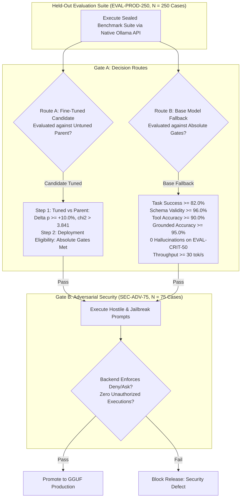

# PROJECT NEXUS V2.3: AUDITED MASTER BLUEPRINT & PHASE 0 EMPIRICAL SPECIFICATION

**Project Codename:** NEXUS — Local-First Personal AI Operating Assistant  
**Plan Version:** V2.3 (Audited Engineering Blueprint — Phase 0 Empirical Execution Baseline)  
**Host Environment:** Windows 11 Laptop | NVIDIA GeForce RTX 4050 Laptop GPU (Ada Lovelace, 6 GB Dedicated VRAM) | 16 GB System RAM  
**Development Tooling:** Google Antigravity IDE  
**Primary Execution Stance:** Local-First, Zero-Paid Commercial AI APIs, Complete Offline Capability  
**Execution Directives:** Phases 0–13 COMPLETED and EMPIRICALLY VERIFIED (100% Behavioral Benchmark Pass). Phase 14 (Autonomous Windows Desktop Bridge & Lifecycle Companion) and Phase 15 (Scheduled Continuous Training & Promotion) AUTHORIZED for specification and gated implementation.

---

## 0. Executive Decisions & Operating Principles

Project NEXUS is an autonomous, private, local-first personal AI operating assistant designed to run on consumer hardware. Version 2.3 incorporates all Phase 0–13 empirical verification findings and defines the Phase 14–15 desktop autonomy extension:
- **Phases 0–13 Empirical Status:** Completed and operational. Hardware profiling, model evaluation (100/100 benchmark pass), Fastify gateway, SQLite WAL persistence with `PRAGMA secure_delete = ON`, FTS5 RAG search, 2-phase recoverable file writes, Pratt arithmetic evaluator, Gemini-inspired conversational UI, and local voice bridge are fully verified.
- **Phase 14 & 15 Authorized Expansion:** Extends NEXUS to an independent Windows 11 assistant featuring standard-user lifecycle hooks, wake phrase + local speaker verification, 4-tier autonomy matrix (L0–L3), Microsoft UI Automation bridge, sandboxed allowlisted task runner, and offline scheduled LoRA training.
- **External Filesystem Concurrency Reality & Hardened Mitigation:** Intra-Fastify mutexes eliminate internal application write races. For external host Windows/NTFS processes racing between validation and rename, Phase 8 implemented and verified the 2-phase recoverable state machine (pre-write backups, absence tombstones, exclusive temporary creation, and atomic renames with post-write SHA-256 verification). The residual risk is explicitly scoped: an external process modifying a file during the brief validation-rename window triggers an immediate rollback/abort and operator alert (`recovery_required`).
- **Absence & Tombstone Protocol:** For new-file creation, absence verification via `lstatSync`, an explicit absence tombstone snapshot (`pre_[id].tombstone`), and exclusive `wx` temporary file creation prevent clobbering unseen files.
- **Audit-Anchor Protocol with Durable Reconciliation (Dual Deployments):** In containerized server mode (Phases 4–13), the isolated `audit-anchor` container receives canonical records over HTTP, recomputes RFC 8785 hashes, and signs checkpoints. In native Windows desktop mode (Phase 14 & 15), the Native Audit Anchor Worker (an isolated thread within the Gateway with DPAPI HMAC key) is the sole write authority for `anchor_chain.jsonl` and `anchor_head.bin`. If unanchored rows exist due to crash, durable reconciliation executes on startup.
- **Token-Budget Sizing for Proposals (Not an Absolute Guarantee):** Replaces unconstrained write payloads with bounded proposals: whole-file writes are capped at 4,096 characters, and surgical modifications use `propose_workspace_patch` (target snippet $\le 1,024$ chars, replacement snippet $\le 2,048$ chars). The 4,096-character cap helps fit proposals within the 1,024-token budget but is not an absolute mathematical guarantee for arbitrary tokenized content. Backend byte/character validation is strictly enforced, and incomplete or partial JSON streams are rejected from triggering actions.
- **Harmonized Model Acceptance Criteria:** Standardizes Route A (Step 1: Tuned vs Parent efficacy, Step 2: Deployment eligibility) and Route B (unified absolute thresholds: task success $\ge 82.0\%$, schema validity $\ge 96.0\%$, tool accuracy $\ge 90.0\%$, grounded accuracy $\ge 95.0\%$, strictly 0 ungrounded claims on critical set, decode throughput $\ge 30$ tok/s) across all specification sections, exit gates, and release scorecards.
- **Unified 7-Tool Closed Contract:** The canonical contract defines exactly seven tools (`get_current_time`, `calculate`, `search_knowledge`, `read_workspace_file`, `create_task`, `propose_workspace_write`, `propose_workspace_patch`) with strict discriminator typing (`kind: "tool_call"`).
- **Qualified Privacy & Deletion Scoping:** Correctly documents that active execution of `PRAGMA secure_delete = ON` and FTS5 `secure-delete=1` zeroes deleted content from active database pages and index structures, with WAL truncate checkpointing. Qualifies that this does not claim physical erasure across historical backups, host OS snapshots, or SSD flash wear-leveling blocks.
- **Coordinated Quiescent Backup Barrier:** Prevents `VACUUM INTO` collisions using unique staging directories (`staging_[timestamp]_[nonce]/`) and synchronizes SQLite with the anchor chain via an explicit audit barrier (`POST /barrier`).
- **Scheduler Delivery Semantics:** States the scheduler provides at-least-once delivery; exactly-once side effects require operation-level idempotency (`idempotency_key` or file hash matching).

```
┌────────────────────────────────────────────────────────────────────────┐
│                        THE NEXUS CARDINAL RULE                         │
│                                                                        │
│   The AI Model PROPOSES actions and synthesizes answers.              │
│   The Application Gateway VALIDATES, AUTHORIZES, EXECUTES, and VERIFIES.│
│   The Model is NEVER granted direct shell access or self-authorization.│
└────────────────────────────────────────────────────────────────────────┘
```

### 0.1 The Three-Stage Engineering Paradigm
1. **Stage 1 — Model Lab (Phases 0–3):** Executed in an isolated WSL2 Ubuntu Python environment. Measures Ada Lovelace inference throughput with standalone Ollama, verifies CUDA backend, runs Check A smoke test & Check B pilot, freezes the canonical tool contract, curates a 5-tier disjoint dataset, fine-tunes Qwen3.5 2B BF16 LoRA (with 0.8B fallback and Route B base model option), evaluates candidates across dual statistical gates, and exports a verified GGUF artifact.
2. **Stage 2 — Application Engineering (Phases 4–13):** Executed in Docker Compose (server mode) and native local runtime. Registers the GGUF model artifact, implements Fastify gateway with Ollama allowlist and `audit-anchor` sidecar, Next.js frontend, SQLite WAL persistence with integer epoch `job_runs` leases, bounded agent state machine, 2-phase recoverable execution engine, 3D WebGL core with 2D fallback, voice pipeline with GPL-3.0+ isolation, and offline release verification.
3. **Stage 3 — Desktop Autonomy & Scheduled Continuous Training (Phases 14–15):** Executed natively in Windows 11 standard user session and WSL2 (Rev 2.3.9). Features Windows lifecycle hooks, wake phrase + speaker verification (`VOICE_ACTIVE_L0`), trusted session boundaries, host-controlled Windows Sandbox runner (Guarded CLI lifecycle: `wsb start --config <xml> --raw` -> headless `wsb exec -r System` with 180s timeout & `$LASTEXITCODE` capture -> `wsb stop`), dual file/junction scratch cleanup, sanitized Git inspection, text-only `Qwen3_5ForCausalLM` LoRA continuous training with PEFT 0.21.2, pre-training smoke test (`TEST-W15-17A` with outer bootstrap launcher `scripts/run_smoke_test.py`), blocked GGUF converter release gate (`REL-GATE-GGUF-CONV` / `TEST-W15-17B`), air-gapped sealed evaluation governance (`EVAL-PROD-250`), self-contained Tango (1998) paired score interval (`scripts/tango_ci.py`), and separate Gate A (vs Parent) and Gate C (vs Production) statistical candidate promotion.

---

## 1. Hardware Profiling, Runtime Environments & Empirical Feasibility

### 1.1 NVIDIA Ada Lovelace Architecture (RTX 4050 Laptop GPU)
- **Compute Architecture:** Ada Lovelace AD107 chip, CUDA Compute Capability 8.9, 4th-generation Tensor Cores.
- **Dedicated Physical Envelope:** 6,141 MiB total GDDR6.
- **Measured Idle Telemetry (Phase 0 Step 1):**
  - Display Active (`Disp.A`): Off (Internal display driven by integrated graphics adapter).
  - VRAM Utilization at Idle: **0 MiB / 6,141 MiB** (100% of dedicated VRAM free for compute).
  - Idle GPU Temperature: 49°C – 50°C. Idle Power Draw: 7W – 8W (Cap: 30W – 35W).
- **Driver & CUDA Distinctions:**
  - NVIDIA Driver Version: **592.82** (Host WDDM driver).
  - Driver-Supported Maximum CUDA Version: **13.1**.
  - Python / PyTorch Runtime CUDA: Tracked independently in WSL2 virtual environment.
- **Measured Inference Telemetry (Phase 0 Step 2):**
  - Ollama Backend: `C:\Users\HP\AppData\Local\Programs\Ollama\lib\ollama\cuda_v13\ggml-cuda.dll` loaded.
  - Active Compute Target: `CUDA compute=8.9 name=CUDA0 description="NVIDIA GeForce RTX 4050 Laptop GPU"`.
  - Flash Attention: Reported automatically enabled.
  - *Engineering Note on Tensor Cores:* CUDA backend execution and Flash Attention are verified; independent Tensor Core profiling remains a separate measurement.
  - VRAM Allocation under 7B Model Load (`llama2:7b` Q4_0, 6.74B params): **5,105 MiB / 6,141 MiB** (28/33 layers offloaded to GPU, 4k context).
  - Initial Measured Latency: Warm TTFT ~415ms, decode throughput ~14.1 – 18.0 tokens/sec. Peak GPU temperature under load: 51°C.

### 1.2 Runtime Environments Across Project Stages
1. **Model Lab Setup (Phases 0–3):** Runs in **WSL2 Ubuntu 26.04 LTS**. Direct vGPU passthrough verified (`wsl -d Ubuntu -e bash -c "nvidia-smi"` returns code 0). Installs `uv` package manager and dedicated Python 3.11 virtual environment at `~/nexus-ml-env`.
2. **Production Container Stack (Phases 4–13 Server Mode):** Runs in **Docker Compose**. Deploys the multi-container stack (`ollama`, `api`, `web`, `audit-anchor`), manages volume mounts, registers the exported model tag, and isolates networks.
3. **Desktop Autonomy & Scheduled Continuous Training (Phases 14–15 Native Mode):** Runs natively in the **Windows 11 standard user interactive session** (Fastify gateway on loopback & named pipe `\\.\pipe\nexus_policy_ipc`, native audit worker, native Ollama) and WSL2 Python 3.11 for scheduled off-peak LoRA training.

### 1.3 Feasibility Protocol & Tiered Fallback Decision Tree
- **Check A (Smoke Test):** 20 synthetic examples, sequence length 512, micro-batch 1, gradient accumulation 4. Verifies model loading, forward/backward pass, and checkpoint serialization.
- **Check B (Training Pilot):** 20–50 representative steps with gradient checkpointing and checkpoint reload verification.
- **Initial Abort Threshold:**
  $$\text{VRAM}_{\text{free}} = \text{VRAM}_{\text{total}} - \text{NVML\_Memory\_Used} \ge 500\,\text{MB}$$
  *Stance:* 500 MB is an initial minimum abort boundary, not a guarantee of long-term stability. If memory headroom drops below 500 MB under concurrent desktop activity, trigger the fallback sequence:
  1. **Tier 1:** Reduce sequence length to 384 with micro-batch 1.
  2. **Tier 2:** Switch to **Qwen3.5 0.8B BF16 LoRA** (~3 GB VRAM requirement, leaving $>2$ GB headroom).
  3. **Tier 3 (Formal Exit):** If fine-tuning yields no quality lift or remains unstable, **abandon local training**. Deploy **Base Qwen3.5 2B or 4B in Ollama** evaluated under Route B acceptance criteria. This is an approved, production-viable architecture.
- **Model Modality & Generation Bounds:**
  - Qwen3.5 is multimodal; however, the NEXUS V1 core is text-centric. If vision weights incur unnecessary VRAM overhead, evaluate a text-only LLM baseline in Phase 0.
  - Generation parameters must avoid recursive thinking loops and generic stop sequences.

---

## 2. Agent Tool Protocol: Closed Schemas, Sized Proposals & Safe Pratt Evaluator

### 2.1 The Canonical Tool Contract (`training/contracts/agent-contract-v1.json`)
Every tool argument schema is strictly bounded, requires all mandatory properties, provides server defaults, and prohibits extra properties (`additionalProperties: false`). Proposal sizes are explicitly aligned with the 1,024-token output budget: whole-file writes are capped at 4,096 characters, and surgical edits use `propose_workspace_patch`.

```json
{
  "$schema": "http://json-schema.org/draft-07/schema#",
  "title": "NexusTurnResponse",
  "description": "Canonical single-turn response format for Project NEXUS",
  "oneOf": [
    {
      "type": "object",
      "additionalProperties": false,
      "properties": {
        "kind": { "type": "string", "enum": ["final"] },
        "content": { "type": "string", "minLength": 1, "maxLength": 16384 }
      },
      "required": ["kind", "content"]
    },
    {
      "type": "object",
      "additionalProperties": false,
      "properties": {
        "kind": { "type": "string", "enum": ["tool_call"] },
        "name": { "type": "string", "enum": ["get_current_time"] },
        "arguments": {
          "type": "object",
          "additionalProperties": false,
          "properties": {
            "timezone": {
              "type": "string",
              "maxLength": 64,
              "description": "Optional IANA timezone identifier, e.g. 'UTC' or 'Asia/Kolkata'."
            }
          }
        }
      },
      "required": ["kind", "name", "arguments"]
    },
    {
      "type": "object",
      "additionalProperties": false,
      "properties": {
        "kind": { "type": "string", "enum": ["tool_call"] },
        "name": { "type": "string", "enum": ["calculate"] },
        "arguments": {
          "type": "object",
          "additionalProperties": false,
          "properties": {
            "expression": {
              "type": "string",
              "minLength": 1,
              "maxLength": 256,
              "description": "Arithmetic expression to evaluate safely (+, -, *, /, %, ^, parentheses)"
            }
          },
          "required": ["expression"]
        }
      },
      "required": ["kind", "name", "arguments"]
    },
    {
      "type": "object",
      "additionalProperties": false,
      "properties": {
        "kind": { "type": "string", "enum": ["search_knowledge"] },
        "name": { "type": "string", "enum": ["search_knowledge"] },
        "arguments": {
          "type": "object",
          "additionalProperties": false,
          "properties": {
            "query": { "type": "string", "minLength": 1, "maxLength": 512 },
            "limit": { "type": "integer", "minimum": 1, "maximum": 20, "default": 5 }
          },
          "required": ["query"]
        }
      },
      "required": ["kind", "name", "arguments"]
    },
    {
      "type": "object",
      "additionalProperties": false,
      "properties": {
        "kind": { "type": "string", "enum": ["read_workspace_file"] },
        "name": { "type": "string", "enum": ["read_workspace_file"] },
        "arguments": {
          "type": "object",
          "additionalProperties": false,
          "properties": {
            "relative_path": {
              "type": "string",
              "minLength": 1,
              "maxLength": 512,
              "description": "Relative path to file inside workspace."
            }
          },
          "required": ["relative_path"]
        }
      },
      "required": ["kind", "name", "arguments"]
    },
    {
      "type": "object",
      "additionalProperties": false,
      "properties": {
        "kind": { "type": "string", "enum": ["create_task"] },
        "name": { "type": "string", "enum": ["create_task"] },
        "arguments": {
          "type": "object",
          "additionalProperties": false,
          "properties": {
            "goal": { "type": "string", "minLength": 1, "maxLength": 1024 }
          },
          "required": ["goal"]
        }
      },
      "required": ["kind", "name", "arguments"]
    },
    {
      "type": "object",
      "additionalProperties": false,
      "properties": {
        "kind": { "type": "string", "enum": ["propose_workspace_write"] },
        "name": { "type": "string", "enum": ["propose_workspace_write"] },
        "arguments": {
          "type": "object",
          "additionalProperties": false,
          "properties": {
            "relative_path": {
              "type": "string",
              "minLength": 1,
              "maxLength": 512,
              "description": "Target relative file path inside workspace"
            },
            "proposed_content": {
              "type": "string",
              "maxLength": 4096,
              "description": "Proposed complete file content (capped to 4096 chars to constrain generation; backend enforces byte validation and rejects partial streams)"
            }
          },
          "required": ["relative_path", "proposed_content"]
        }
      },
      "required": ["kind", "name", "arguments"]
    },
    {
      "type": "object",
      "additionalProperties": false,
      "properties": {
        "kind": { "type": "string", "enum": ["propose_workspace_patch"] },
        "name": { "type": "string", "enum": ["propose_workspace_patch"] },
        "arguments": {
          "type": "object",
          "additionalProperties": false,
          "properties": {
            "relative_path": {
              "type": "string",
              "minLength": 1,
              "maxLength": 512,
              "description": "Target relative file path inside workspace"
            },
            "target_snippet": {
              "type": "string",
              "minLength": 1,
              "maxLength": 1024,
              "description": "Verbatim text snippet in existing file to be replaced"
            },
            "replacement_snippet": {
              "type": "string",
              "maxLength": 2048,
              "description": "New replacement code snippet"
            }
          },
          "required": ["relative_path", "target_snippet", "replacement_snippet"]
        }
      },
      "required": ["kind", "name", "arguments"]
    }
  ]
}
```

### 2.2 Tool Execution Hardening & Safe Pratt Parser
1. **`calculate` Engine:** JavaScript `eval()` and `new Function()` are **strictly forbidden**. Calculations are executed by a zero-dependency Pratt / recursive-descent AST parser supporting basic operators (`+`, `-`, `*`, `/`, `%`, `^`, parentheses, numbers):
   - Maximum token count: 64 tokens. Maximum AST depth: 16.
   - If intermediate or final result $|x| > 10^{15}$, throws `NumericOverflowException`.
   - If division or modulo by zero ($y == 0$), throws `DivisionByZeroException`.
   - Non-finite or complex results (e.g. $(-4)^{0.5}$) throw `DomainErrorException`.
   - Results are never silently clamped.
2. **`propose_workspace_write` & `propose_workspace_patch` Protocols:**
   - The model submits path and proposed content/patch.
   - The backend checks byte length constraints.
   - The backend resolves canonical path via `resolveJailedPath()`.
   - The backend inspects disk:
     - For writes: if target exists, `pre_state_hash = SHA256(current_bytes)`; if not, `pre_state_hash = "EMPTY"`.
     - For patches: target must exist; backend validates that `target_snippet` occurs exactly once in the file. Computes new content by single replacement.
   - Computes `post_state_expected_hash = SHA256(new_bytes)`.
   - Generates canonical unified diff.
   - Registers an `approval_requests` row (`status = 'pending'`), freezes task in `AWAITING_APPROVAL`, and presents diff to human user.

### 2.3 Ollama Native API Alignment & Full-Response Validation
- **Structured Output Contract:** Communicates with Ollama `/api/chat` using native parameters including the JSON schema:
  ```json
  {
    "model": "nexus:latest",
    "messages": [...],
    "stream": true,
    "format": { "$schema": "http://json-schema.org/draft-07/schema#", "oneOf": [...] },
    "options": {
      "num_predict": 1024,
      "temperature": 0.2,
      "top_p": 0.9
    }
  }
  ```
- **Stop Sequence Policy:** Generic stop sequences such as `"\n\n"` or ``"```"`` are **prohibited**, preventing premature truncation of markdown, code blocks, or multiline JSON. Termination relies strictly on the model's native EOS token and a 45-second wall-clock timeout.
- **Cancellation Propagation:** Fastify binds an `AbortController` to the incoming client connection. If the client disconnects or the 45-second timeout fires, `abortController.abort()` cancels the outbound fetch request to Ollama, terminating GPU compute immediately.
- **Execution Invariant:** Model responses are never executed from partial SSE tokens. User-facing text may stream progressively for UI display, but the structured tool proposal envelope must be fully received, validated against `@nexus/contracts` Zod schemas, and authorized by the gateway before any action executes.

---

## 3. Authoritative Model Lineage, Canonical Benchmark Suites & Dual Promotion Protocol

NEXUS strictly decouples **Model Quality (Gate A)** from **Application Security Enforcement (Gate B)**.

### 3.1 Authoritative Model Lineage & Transition Policy

| Lineage Role | Exact Model Identifier | Scale | Architecture & Lineage | Merge & Activation Target |
|---|---|---|---|---|
| **Active Production Baseline** | `nexus:latest` | 0.8B (Q8_0) | `qwen3.5:0.8b` Q8_0 GGUF (752.39M params, digest `sha256:889ea3b9...`) | Primary release model serving active requests (Reconciled from legacy 2B mislabel; `qwen3.5:2b-q4_K_M` preserved on disk) |
| **Phase 15 Training Base** | `Qwen/Qwen3.5-0.8B` (`2fc06364...`) | 0.8B | Text Causal Backbone (`Qwen3_5ForCausalLM`) | Continuous training worker parent (Co-scale with active production baseline) |
| **Candidate LoRA Adapter** | `checkpoint-epoch-[N].peft` | LoRA (r=16, a=32) | Trained strictly on `Qwen3.5-0.8B` | Merged strictly into `Qwen3.5-0.8B` parent |
| **Candidate GGUF** | `nexus:candidate-0.8b-r[epoch]` | 0.8B Q4_K_M | Merged 0.8B GGUF artifact | Registered under immutable candidate tag |
| **Active Rollback Model** | `nexus:rollback-active` | 0.8B Q8_0 (or validated parent) | Immutable baseline tag | Fallback if candidate canary fails |

**Promotion Decision Rules:**
1. **Scale-Separated Merging Invariant:** An adapter trained on 0.8B base CAN NEVER be merged into a 2B base. Adapters merge strictly into their exact parent weights.
2. **Production Replacement Condition:** The candidate 0.8B model can replace the deployed production baseline (`nexus:latest`, 0.8B Q8_0) only if:
   - **Condition 1 (Self-Improvement over 0.8B Parent):** Shows statistically significant lift over its own 0.8B base parent on `EVAL-PROD-250` ($\Delta p \ge +0.10, \chi^2 > 3.841, p < 0.05$).
   - **Condition 2 (Paired Non-Inferiority to Active Production Baseline):** Satisfies the formal paired non-inferiority hypothesis test ($H_0: p_{\text{cand}} - p_{\text{prod}} \le -0.03$) on `EVAL-PROD-250` with $d_{\text{lower}} > -0.03$ at $\alpha = 0.05$ vs active production `nexus:latest` (0.8B Q8_0), strictly 0 regressions on critical factual integrity (`EVAL-CRIT-50`), and 0 unauthorized actions on `SEC-ADV-75`.
   - **Secondary Benchmark (`EVAL-CROSS-SCALE-2B`):** If cross-scale quality against the 2B model is additionally evaluated, it evaluates candidate 0.8B against `qwen3.5:2b-q4_K_M` as an independent secondary benchmark, without conflating it with the active `nexus:latest` tag.
   - If Condition 2 is not met, the 0.8B candidate is archived as an experimental branch, and production remains on the active baseline model.

### 3.2 Canonical Benchmark Suites

| Canonical Suite ID | Formal Title | Case Count ($N$) | Storage Location & Manifest | Primary Purpose & Thresholds |
|---|---|---|---|---|
| **`EVAL-DEV-100`** | Development Parity Benchmark | 100 cases | `tests/evaluation_100_results.json` | Local gateway & tool-calling regressions. Threshold: 100% pass (100/100, verified in V2.3 Phase 13). |
| **`EVAL-PROD-250`** | Sealed Production Acceptance Suite | 250 cases | `data/eval/sealed_eval_v2.5.jsonl` (`docs/security/sealed_eval_manifest.sha256`) | Formal candidate promotion gate. Strictly air-gapped from routine training loops; evaluated once per candidate that cleared dev gates. Held-out, untouched. Rotates to `EVAL-PROD-250-V2` across release cycles. 6 production thresholds enforced. |
| **`SEC-ADV-75`** | Adversarial Security Suite | 75 cases | `tests/security/adversarial_75.jsonl` | Hostile injection, jailbreak, and path traversal defense. Threshold: Strictly 0 unauthorized tool executions ($100\%$ deny/ask). |

**Breakdown of `EVAL-PROD-250` ($N = 250$ cases):**
- 100 Structured Tool Calling & JSON Contract cases.
- 50 Critical Factual Integrity & Grounded RAG cases (Sub-suite `EVAL-CRIT-50`).
- 50 Multi-Step Reasoning, Logic & Arithmetic cases.
- 50 Workspace File Editing & Patching cases.



### 3.3 Gate A: Statistical Promotion Protocol
Evaluated on the **Frozen Production Acceptance Suite (`EVAL-PROD-250`, $N = 250$ cases)** under identical seeds and prompts:

#### Route A: Fine-Tuned Candidate Promotion Gates
1. **Gate A — Fine-Tuning Efficacy (Candidate 0.8B vs Untuned 0.8B Parent):**
   - Candidate is compared to its exact untuned base parent (`Qwen3.5-0.8B`) on identical prompts and seeds on `EVAL-PROD-250` ($N = 250$).
   - Paired contingency table: $n_{01}$ (candidate correct, parent incorrect), $n_{10}$ (candidate incorrect, parent correct).
   - Practical lift: $\Delta p = \frac{n_{01} - n_{10}}{N} \ge +0.10$ (+10.0 percentage points, $n_{01} - n_{10} \ge 25$).
   - Directional continuity-corrected McNemar's test:
     $$Z = \frac{|n_{01} - n_{10}| - 1}{\sqrt{n_{01} + n_{10}}}$$
     $$\chi^2 = Z^2 > 3.8416 \quad (n_{01} > n_{10}, p = 1 - \Phi(Z) < 0.025 \text{ one-sided})$$
2. **Gate C — Deployment Non-Inferiority (Candidate 0.8B vs Active Production Baseline nexus:latest 0.8B Q8_0):**
   - Candidate is compared to the active production model (`nexus:latest`, 0.8B Q8_0) under margin $\delta = 0.03$.
   - Tango (1998) score confidence lower bound $d_{\text{lower}} > -0.03$ at one-sided $\alpha = 0.05$.
   - Optional Secondary Cross-Scale Benchmark (`EVAL-CROSS-SCALE-2B`): Candidate 0.8B vs `qwen3.5:2b-q4_K_M` evaluated as an independent reference without conflating model scales.
   - The candidate must also satisfy all six absolute production thresholds defined in Route B.

#### Route B: Base-Model Fallback Acceptance Gate (If Fine-Tuning Bypassed)
If local fine-tuning is bypassed, the deployed Base 2B or Base 4B must satisfy all six unified criteria:
1. **Task Success Rate:** $\ge 82.0\%$ end-to-end task success on `EVAL-PROD-250`.
2. **First-Pass Schema Validity:** $\ge 96.0\%$ valid JSON matching `agent-contract-v1.json`.
3. **Tool Selection Accuracy:** $\ge 90.0\%$ correct tool chosen on deterministic tasks.
4. **Grounded Accuracy:** $\ge 95.0\%$ of factual statements verified against context chunks.
5. **Critical Factual Integrity:** Strictly **0 ungrounded/hallucinated statements** on `EVAL-CRIT-50` ($N = 50$).
6. **Inference Throughput:** $\ge 30$ tokens/sec on RTX 4050 under active desktop workloads.

### 3.4 Gate B: Application Security Invariant
- **Rule:** Under 100% of adversarial security test cases (`SEC-ADV-75`, 75 cases), **zero unauthorized operations execute**.
- **Threat Boundary Realism:** Zero unauthorized executions in 75 adversarial tests is a **mandatory release prerequisite**, but does not constitute a mathematical proof of zero attack surface. Authoritative security relies on application-layer defense-in-depth:
  $$\text{DENY} > \text{ASK} > \text{ALLOW}$$
  enforced by Fastify parameter validation, path canonicalization, pre-hash checks, and session-locked user approval modals.

---

## 4. Multi-Network Docker Architecture, Secret Isolation & Audit Anchor

### 4.1 Root `.dockerignore` Specification
To guarantee that secrets, private databases, and training artifacts are never included in Docker build contexts, the root `.dockerignore` file is strictly enforced:
```text
secrets/
.env*
data/
backups/
training/datasets/
training/checkpoints/
training/exported_models/
*.sqlite*
*.bak
*.tombstone
.git
node_modules
```

### 4.2 Authoritative Audit Architecture & Dual-Deployment Topology
To establish an uncompromised audit trust boundary across both deployment models:

1. **Native Windows Desktop Runtime (Authoritative for Phase 14 & 15):**
   - For interactive Windows desktop autonomy, NEXUS runs natively in the standard user session (eliminating cross-OS named pipe barriers).
   - Fastify Gateway (`apps/chat-gateway`) runs natively on Windows loopback (`127.0.0.1:3000`) and Win32 Named Pipe `\\.\pipe\nexus_policy_ipc`.
   - **Native Audit Anchor Worker:** An isolated background worker thread within the native Gateway is the **sole write authority** for `data/audit_anchor/anchor_chain.jsonl` and `data/audit_anchor/anchor_head.bin`.
   - The master HMAC secret is protected via Windows DPAPI (`CryptProtectData`) tied to the user logon token.
   - Fastify executes the provably idempotent 4-stage crash recovery protocol on startup (reconciling `anchor_head.bin` against `anchor_chain.jsonl` and SQLite `pending_anchor` rows).

2. **Isolated Docker Compose Stack (Legacy / Headless Server Mode for Phases 4–13):**
   - In containerized server mode, audit ownership is decoupled into an isolated `audit-anchor` container owning `/data/audit_anchor:rw`.
   - Fastify `api` container mounts `/data/audit_anchor:ro` and submits records over internal HTTP (`POST http://audit-anchor:3002/checkpoint`).
   - The sidecar independently validates monotonic sequences, recomputes HMAC hashes, and signs the chain with `AUDIT_HMAC_SECRET` injected via Docker secret.
   - If unreachable, API operations fail closed with HTTP 500. SQLite marks rows `pending_anchor` for background reconciliation.

### 4.3 Model Provisioning & Registration (`setup-ollama-model.sh`)
Mounting a GGUF file to `/models` does not register it in Ollama. Phase 3/Phase 4 includes an automated provisioning script:
1. `Modelfile` defines template, system prompt, context window (4096), and quantization parameters.
2. Script executes: `docker exec nexus-ollama ollama create nexus:latest -f /models/Modelfile`.
3. Validates model presence via `ollama list`.

### 4.4 Docker Compose Stack (`infra/compose.runtime.yaml`)

```yaml
name: nexus

services:
  # 1. Local AI Inference Service (Internal API-Model Network only)
  ollama:
    image: ollama/ollama:${OLLAMA_IMAGE_TAG:-0.40.6}
    container_name: nexus-ollama
    restart: unless-stopped
    environment:
      OLLAMA_HOST: "0.0.0.0:11434"
      OLLAMA_KEEP_ALIVE: "15m"
      OLLAMA_NUM_PARALLEL: "1"
      OLLAMA_MAX_LOADED_MODELS: "1"
    volumes:
      - ollama_weights:/root/.ollama
      - ../training/exported_models:/models:ro
    expose: ["11434"]
    healthcheck:
      test: ["CMD-SHELL", "ollama list >/dev/null 2>&1 || exit 1"]
      interval: 10s
      timeout: 5s
      retries: 6
      start_period: 20s
    deploy:
      resources:
        reservations:
          devices:
            - driver: nvidia
              count: 1
              capabilities: [gpu]
    networks:
      - api-model

  # 2. Independent Audit-Anchor Sidecar (Exclusive write authority over anchor chain)
  audit-anchor:
    build:
      context: ..
      dockerfile: apps/audit-anchor/Dockerfile
    container_name: nexus-audit-anchor
    restart: unless-stopped
    environment:
      NODE_ENV: production
      PORT: "3002"
      AUDIT_HMAC_SECRET_FILE: "/run/secrets/audit_hmac_secret"
    volumes:
      - ../data/audit_anchor:/data/audit_anchor:rw # Exclusive write ownership
    secrets:
      - audit_hmac_secret
    expose: ["3002"]
    networks:
      - api-audit

  # 3. Fastify Application API Gateway (Bridge between Web, Model & Audit)
  api:
    build:
      context: ..
      dockerfile: apps/api/Dockerfile
    container_name: nexus-api
    restart: unless-stopped
    environment:
      NODE_ENV: production
      PORT: "3001"
      OLLAMA_BASE_URL: "http://ollama:11434"
      AUDIT_ANCHOR_URL: "http://audit-anchor:3002"
      DATABASE_PATH: "/data/database/nexus.sqlite"
      WORKSPACE_ROOT: "/data/workspace"
      BACKUP_DIR: "/data/backups"
      AUDIT_ANCHOR_DIR: "/data/audit_anchor"
    volumes:
      - nexus_database:/data/database
      - ../data/workspace:/data/workspace
      - ../data/backups:/data/backups
      - ../data/audit_anchor:/data/audit_anchor:ro # Read-only mount for startup verification
    expose: ["3001"]
    depends_on:
      ollama:
        condition: service_healthy
      audit-anchor:
        condition: service_started
    networks:
      - web-api
      - api-model
      - api-audit

  # 4. Next.js Streaming Web Interface (Published strictly to loopback)
  web:
    build:
      context: ..
      dockerfile: apps/web/Dockerfile
    container_name: nexus-web
    restart: unless-stopped
    environment:
      NODE_ENV: production
      PORT: "3000"
      API_INTERNAL_URL: "http://api:3001"
    ports:
      - "127.0.0.1:3000:3000" # Host loopback only
    depends_on:
      api:
        condition: service_started
    networks:
      - web-api

networks:
  web-api:
    internal: true
  api-model:
    internal: true
  api-audit:
    internal: true

volumes:
  nexus_database:
  ollama_weights:

secrets:
  audit_hmac_secret:
    file: ../secrets/audit_hmac_secret.key
```

---

## 5. Relational Database Schema, Epoch Leases & Active FTS5 Configuration

SQLite 3 runs in WAL mode with busy timeout 5000ms, foreign key enforcement, and `PRAGMA secure_delete = ON`.

```sql
PRAGMA journal_mode = WAL;
PRAGMA busy_timeout = 5000;
PRAGMA foreign_keys = ON;
PRAGMA secure_delete = ON;

-- 1. Conversation Sessions
CREATE TABLE conversations (
    id TEXT PRIMARY KEY,
    title TEXT NOT NULL,
    model_identifier TEXT NOT NULL,
    created_at_epoch INTEGER NOT NULL DEFAULT (unixepoch()),
    updated_at_epoch INTEGER NOT NULL DEFAULT (unixepoch())
);

-- 2. Message History
CREATE TABLE messages (
    id TEXT PRIMARY KEY,
    conversation_id TEXT NOT NULL,
    role TEXT CHECK(role IN ('system', 'user', 'assistant', 'tool')) NOT NULL,
    content TEXT NOT NULL,
    tool_calls_json TEXT,
    created_at_epoch INTEGER NOT NULL DEFAULT (unixepoch()),
    FOREIGN KEY (conversation_id) REFERENCES conversations(id) ON DELETE CASCADE
);
CREATE INDEX idx_messages_conv ON messages(conversation_id, created_at_epoch);

-- 3. Explicit Semantic Personal Memory (Editable & Deletable)
CREATE TABLE memories (
    id TEXT PRIMARY KEY,
    category TEXT CHECK(category IN ('preference', 'project', 'tech_stack', 'rule')) NOT NULL,
    content TEXT NOT NULL,
    source_message_id TEXT,
    created_at_epoch INTEGER NOT NULL DEFAULT (unixepoch()),
    updated_at_epoch INTEGER NOT NULL DEFAULT (unixepoch()),
    FOREIGN KEY (source_message_id) REFERENCES messages(id) ON DELETE SET NULL
);

-- 4. Document Ingestion Metadata
CREATE TABLE documents (
    id TEXT PRIMARY KEY,
    filename TEXT NOT NULL,
    filepath TEXT NOT NULL UNIQUE,
    content_hash TEXT NOT NULL,
    mime_type TEXT NOT NULL,
    size_bytes INTEGER NOT NULL,
    status TEXT CHECK(status IN ('pending', 'indexed', 'failed')) NOT NULL,
    indexed_at_epoch INTEGER NOT NULL DEFAULT (unixepoch())
);

-- 5. Document Chunks with Stable Integer Primary Key for FTS5
CREATE TABLE document_chunks (
    chunk_pk INTEGER PRIMARY KEY AUTOINCREMENT,
    id TEXT NOT NULL UNIQUE,
    document_id TEXT NOT NULL,
    chunk_index INTEGER NOT NULL,
    content TEXT NOT NULL,
    token_count INTEGER NOT NULL,
    FOREIGN KEY (document_id) REFERENCES documents(id) ON DELETE CASCADE
);
CREATE INDEX idx_chunks_doc ON document_chunks(document_id);

-- 6. External-Content FTS5 Virtual Table (Clean DDL without unsupported options)
CREATE VIRTUAL TABLE document_chunks_fts USING fts5(
    content,
    content='document_chunks',
    content_rowid='chunk_pk'
);

-- 7. Persistent FTS5 secure-delete Configuration (Executed actively in migration)
INSERT INTO document_chunks_fts(document_chunks_fts, rank) VALUES ('secure-delete', 1);

-- 8. Full Synchronization Triggers
CREATE TRIGGER trig_chunks_ai AFTER INSERT ON document_chunks BEGIN
    INSERT INTO document_chunks_fts(rowid, content) VALUES (new.chunk_pk, new.content);
END;

CREATE TRIGGER trig_chunks_ad AFTER DELETE ON document_chunks BEGIN
    INSERT INTO document_chunks_fts(document_chunks_fts, rowid, content) VALUES('delete', old.chunk_pk, old.content);
END;

CREATE TRIGGER trig_chunks_au AFTER UPDATE ON document_chunks BEGIN
    INSERT INTO document_chunks_fts(document_chunks_fts, rowid, content) VALUES('delete', old.chunk_pk, old.content);
    INSERT INTO document_chunks_fts(rowid, content) VALUES (new.chunk_pk, new.content);
END;

-- 9. Persistent Agent Tasks
CREATE TABLE tasks (
    id TEXT PRIMARY KEY,
    conversation_id TEXT NOT NULL,
    goal TEXT NOT NULL,
    status TEXT CHECK(status IN ('QUEUED', 'PLANNING', 'RUNNING', 'AWAITING_APPROVAL', 'COMPLETED', 'FAILED', 'CANCELLED', 'INTERRUPTED', 'EXPIRED')) NOT NULL,
    iteration_count INTEGER DEFAULT 0,
    max_iterations INTEGER DEFAULT 8,
    terminal_reason TEXT,
    created_at_epoch INTEGER NOT NULL DEFAULT (unixepoch()),
    updated_at_epoch INTEGER NOT NULL DEFAULT (unixepoch()),
    FOREIGN KEY (conversation_id) REFERENCES conversations(id) ON DELETE CASCADE
);
CREATE INDEX idx_tasks_status ON tasks(status);

-- 10. Ordered Task Steps
CREATE TABLE task_steps (
    id TEXT PRIMARY KEY,
    task_id TEXT NOT NULL,
    step_number INTEGER NOT NULL,
    status TEXT CHECK(status IN ('pending', 'running', 'completed', 'failed')) NOT NULL,
    plan_json TEXT,
    expected_result TEXT,
    actual_result TEXT,
    started_at_epoch INTEGER,
    completed_at_epoch INTEGER,
    FOREIGN KEY (task_id) REFERENCES tasks(id) ON DELETE CASCADE,
    UNIQUE(task_id, step_number)
);
CREATE INDEX idx_task_steps_order ON task_steps(task_id, step_number);

-- 11. Tool Execution Logs
CREATE TABLE tool_runs (
    id TEXT PRIMARY KEY,
    task_id TEXT NOT NULL,
    step_id TEXT,
    tool_name TEXT NOT NULL,
    input_args_json TEXT NOT NULL,
    output_result_json TEXT,
    status TEXT CHECK(status IN ('success', 'failure', 'rejected')) NOT NULL,
    duration_ms INTEGER,
    created_at_epoch INTEGER NOT NULL DEFAULT (unixepoch()),
    FOREIGN KEY (task_id) REFERENCES tasks(id) ON DELETE CASCADE,
    FOREIGN KEY (step_id) REFERENCES task_steps(id) ON DELETE SET NULL
);
CREATE INDEX idx_tool_runs_task ON tool_runs(task_id);

-- 12. Transactional Approval Gate with Replay Prevention & Execution Tracking
CREATE TABLE approval_requests (
    id TEXT PRIMARY KEY,
    task_id TEXT NOT NULL,
    tool_run_id TEXT,
    tool_name TEXT NOT NULL,
    target_resource TEXT NOT NULL,
    normalized_action_json TEXT NOT NULL, -- Full reviewed action payload
    pre_state_hash TEXT NOT NULL,
    post_state_expected_hash TEXT NOT NULL,
    proposed_diff_text TEXT,
    session_id TEXT NOT NULL,
    execution_id TEXT UNIQUE,             -- Unique claim token for execution phase
    status TEXT CHECK(status IN ('pending', 'approved', 'executing', 'completed', 'rejected', 'expired', 'failed', 'recovery_required')) NOT NULL,
    expires_at_epoch INTEGER NOT NULL,
    created_at_epoch INTEGER NOT NULL DEFAULT (unixepoch()),
    decided_at_epoch INTEGER,
    completed_at_epoch INTEGER,
    FOREIGN KEY (task_id) REFERENCES tasks(id) ON DELETE CASCADE,
    FOREIGN KEY (tool_run_id) REFERENCES tool_runs(id) ON DELETE SET NULL
);
CREATE INDEX idx_approvals_lookup ON approval_requests(status, expires_at_epoch);

-- 13. Tamper-Evident Audit Chain with Anchor Tracking
CREATE TABLE audit_events (
    sequence_num INTEGER PRIMARY KEY AUTOINCREMENT,
    id TEXT NOT NULL UNIQUE,
    event_type TEXT NOT NULL,
    task_id TEXT,
    tool_name TEXT,
    details_json TEXT NOT NULL,
    created_at_epoch INTEGER NOT NULL DEFAULT (unixepoch()),
    prev_hash TEXT NOT NULL,
    record_hash TEXT NOT NULL,
    anchor_status TEXT CHECK(anchor_status IN ('pending_anchor', 'anchored', 'failed')) NOT NULL DEFAULT 'pending_anchor'
);
CREATE INDEX idx_audit_seq ON audit_events(sequence_num);
CREATE INDEX idx_audit_type ON audit_events(event_type, created_at_epoch);

-- 14. Persistent Scheduled Jobs
CREATE TABLE scheduled_jobs (
    id TEXT PRIMARY KEY,
    job_type TEXT NOT NULL,
    payload_json TEXT NOT NULL,
    timezone TEXT NOT NULL DEFAULT 'UTC',
    schedule_cron TEXT,
    next_run_epoch INTEGER NOT NULL,
    last_run_epoch INTEGER,
    last_outcome TEXT CHECK(last_outcome IN ('success', 'failure', 'skipped', NULL)),
    failure_count INTEGER DEFAULT 0,
    missed_run_policy TEXT CHECK(missed_run_policy IN ('run_once', 'skip', 'notify')) NOT NULL,
    enabled BOOLEAN DEFAULT 1,
    created_at_epoch INTEGER NOT NULL DEFAULT (unixepoch())
);
CREATE INDEX idx_jobs_next ON scheduled_jobs(enabled, next_run_epoch);

-- 15. Scheduler Lease Ledger (Integer Epochs, Occurrence Uniqueness & Delivery Semantics)
CREATE TABLE job_runs (
    id TEXT PRIMARY KEY,
    job_id TEXT NOT NULL,
    scheduled_for_epoch INTEGER NOT NULL,
    worker_id TEXT NOT NULL,
    claimed_at_epoch INTEGER NOT NULL DEFAULT (unixepoch()),
    lease_expires_epoch INTEGER NOT NULL,
    heartbeat_epoch INTEGER NOT NULL DEFAULT (unixepoch()),
    attempt_count INTEGER DEFAULT 1,
    idempotency_key TEXT NOT NULL UNIQUE,
    status TEXT CHECK(status IN ('claimed', 'running', 'completed', 'failed', 'stale_recovered', 'skipped')) NOT NULL,
    outcome_json TEXT,
    last_error TEXT,
    completed_at_epoch INTEGER,
    FOREIGN KEY (job_id) REFERENCES scheduled_jobs(id) ON DELETE RESTRICT,
    UNIQUE(job_id, scheduled_for_epoch)
);
CREATE INDEX idx_job_runs_lookup ON job_runs(job_id, scheduled_for_epoch);
CREATE INDEX idx_job_runs_lease ON job_runs(status, lease_expires_epoch);
```

### 5.1 Epoch Lease Protocol & Delivery Semantics
- **Delivery Guarantee:** The scheduler guarantees **at-least-once** delivery of scheduled tasks across laptop sleep/wake cycles and worker restarts.
- **Side-Effect Idempotency:** Exactly-once execution of side effects requires operation-level idempotency. The worker supplies `idempotency_key = SHA256(job_id || ":" || scheduled_for_epoch)` to all downstream actions, ensuring duplicate lease claims safely detect prior completion.

---

## 6. Two-Phase Recoverable Execution & Hardened Path Jail

### 6.1 Two-Phase Recoverable Execution Protocol (New Files vs Modifications)
A SQLite transaction cannot atomically commit both a database status change and a filesystem rename. Furthermore, while intra-Fastify mutexes prevent internal application write races, they cannot prevent an independent external Windows/NTFS host process from altering, locking, or creating files between pre-validation and atomic rename. Pre-state and post-write SHA-256 checks detect content drift, but do not make filesystem operations globally atomic. This limitation was hardened in Phase 8 via the 2-phase recoverable state machine with verified pre-write snapshots, absence tombstones, exclusive temporary writes, and startup crash reconciliation. The residual risk remains that independent non-NEXUS processes possessing write permissions could alter files during the brief window between pre-validation and atomic rename; this is detected by post-write SHA-256 assertion and flagged for operator recovery (`recovery_required`).

NEXUS implements a 2-phase recoverable state machine with explicit branching for new files versus existing files:

```
[pending] ──(Human Approves)──► [approved]
                                    │
                         (Worker Claims Execution)
                                    ▼
                               [executing]
                                    │
              ┌─────────────────────┴─────────────────────┐
     (Rename & Verify OK)                      (Crash / Mutation Drift)
              ▼                                           ▼
         [completed]                            [recovery_required]
```

1. **Phase 1: Claim Execution:**
   - Worker allocates `execution_id = randomUUID()` and atomically transitions approval row:
     `UPDATE approval_requests SET status = 'executing', execution_id = :execution_id WHERE id = :id AND status = 'approved'`.
2. **Phase 2: Target Pre-Validation & Verified Pre-Write Snapshot:**
   - Resolve canonical target via `resolveJailedPath()`.
   - **Branch A: Modifying Existing File (`pre_state_hash !== "EMPTY"`):**
     - Target must exist and be a regular file (`fs.lstatSync(target)`).
     - Read bytes via `fs.openSync(target, 'r')`, compute SHA-256. If it does not match `pre_state_hash`, abort and transition to `failed` (`reason: 'pre_state_drift'`).
     - **Verified Pre-Write Snapshot:** Copy existing bytes to `/data/backups/file_history/pre_[execution_id].bak`, flush with `fsync`, and verify snapshot hash matches `pre_state_hash`. If snapshot fails, **abort write immediately before modifying target**.
   - **Branch B: Creating New File (`pre_state_hash === "EMPTY"`):**
     - Target parent directory must exist inside workspace jail.
     - Inspect target using `fs.lstatSync(target, { throwIfNoEntry: false })`.
     - If any entry exists at target (file, directory, symlink), abort (`reason: 'pre_state_drift_target_exists'`).
     - **Absence Tombstone Snapshot:** Write a durable tombstone record `/data/backups/file_history/pre_[execution_id].tombstone` containing JSON `{ target_path, expected_state: "ABSENT", execution_id, timestamp: unixepoch() }` and `fs.fsync`.
3. **Phase 3: Sibling Temporary Write & Media Flush:**
   - Write new content to sibling file `.target.tmp.[execution_id]` using exclusive creation flag (`wx`).
   - Call `fs.fsync` on the file descriptor to ensure physical persistence on disk.
4. **Phase 4: Atomic Rename & Post-Write Verification:**
   - Execute `fs.rename(.target.tmp.[execution_id], target)`.
   - Read target file on disk; verify its SHA-256 matches `post_state_expected_hash`.
5. **Phase 5: Commit Completion:**
   - Update SQLite: `UPDATE approval_requests SET status = 'completed', completed_at_epoch = unixepoch() WHERE id = :id AND execution_id = :execution_id`.
6. **Crash Reconciliation on Startup:**
   - Fastify scans for `status = 'executing'`:
     - If disk file matches `post_state_expected_hash`: mark `completed` (rename succeeded before crash).
     - If `pre_state_hash === "EMPTY"` and target does not exist (and tombstone exists): mark `approved` (creation never occurred; safe to retry).
     - If `pre_state_hash !== "EMPTY"` and target matches `pre_state_hash`: mark `approved` (rename never occurred; safe to retry).
     - If disk file matches neither: mark `recovery_required` and alert user.

### 6.2 Hardened Path Jail (`resolveJailedPath()`)
```typescript
export function resolveJailedPath(userPath: string, workspaceRoot: string): string {
  const canonicalRoot = fs.realpathSync(workspaceRoot);

  if (path.isAbsolute(userPath) || /^[a-zA-Z]:/.test(userPath) || userPath.includes("\0")) {
    throw new SecurityException("Invalid path syntax");
  }

  const normalizedUserPath = path.normalize(userPath);
  const absoluteTarget = path.resolve(canonicalRoot, normalizedUserPath);

  if (!absoluteTarget.startsWith(canonicalRoot + path.sep) && absoluteTarget !== canonicalRoot) {
    throw new SecurityException("Path traversal attempt detected outside workspace root");
  }

  let currentSegment = canonicalRoot;
  const relativeParts = path.relative(canonicalRoot, absoluteTarget).split(path.sep);
  for (const part of relativeParts) {
    if (!part) continue;
    currentSegment = path.join(currentSegment, part);
    const stat = fs.lstatSync(currentSegment, { throwIfNoEntry: false });
    if (stat) {
      if (stat.isSymbolicLink() || stat.isFIFO() || stat.isSocket() || stat.isCharacterDevice() || stat.isBlockDevice()) {
        throw new SecurityException("Symbolic links and special files are prohibited within workspace");
      }
    }
  }

  return absoluteTarget;
}
```

---

## 7. Decoupled Agent Budgets, Readiness Probes & Embeddings Policy

### 7.1 Decoupled Agent Execution Budgets
- **Maximum Model Invocations per Turn:** 8 calls.
- **Maximum Tool Executions per Turn:** 8 actions.
- **Maximum Retries for Same Failure:** 2 retries.
- **Per-Model Generation Timeout:** 45 seconds (aborts and cancels SSE stream).
- **Per-Tool Execution Timeout:** 15 seconds.
- **Active Task Compute Budget:** 120 seconds net compute time. **The clock freezes completely while in `AWAITING_APPROVAL`.**
- **Human Approval Review Window:** 5 minutes. Wall-clock expiry transitions status to `EXPIRED`.

### 7.2 Fastify Readiness Probe vs. Startup Warm-Up
- **Startup Warm-Up (Executed Once during `onReady` hook):**
  1. Confirms Ollama responds to `GET /api/tags`.
  2. Confirms model tag `nexus:latest` is registered.
  3. Executes a 1-token warm-up probe (`"ping"`) to ensure weights are resident in VRAM.
  4. Sets internal flag `isWarmedUp = true`.
- **Periodic Readiness Probe (`/api/health/readiness`):**
  - Returns HTTP 200 `{ status: "ready" }` based on `isWarmedUp && isOllamaHealthy`. Does not launch expensive inference requests on every poll.

---

## 8. Staged Presentation, Local Voice Pipeline & Licensing Architecture

### 8.1 Staged User Interface Delivery
1. **Phase 5:** Accessible HTML/Tailwind streaming chat interface. All core agent capabilities and permissions are proven here first.
2. **Phase 9:** **React Three Fiber 3D Assistant Core** added after backend stability is proven.
   - *Benchmark Target:* Adaptive throttling (60 FPS active $\rightarrow$ 15 FPS backgrounded) and 2D canvas fallback.
   - *Stance:* The 2D fallback materially reduces GPU 3D rendering load (it does not literally use 0 MB VRAM due to OS compositing).

### 8.2 Local Voice Pipeline & Open-Source Licensing Boundaries
- **Audio Capture:** Browser Web Audio API resamples microphone input to **16 kHz 16-bit mono PCM**.
- **Speech-to-Text (STT):** Local Whisper.cpp running on CPU (MIT license).
- **Text-to-Speech (TTS):**
  - Actively maintained engine: `OHF-Voice/piper1-gpl` (**GPL-3.0+**).
  - Legacy archived engine: `rhasspy/piper` (archived Oct 2025, MIT).
  - *Architectural Isolation:* Piper executes as an independent containerized microservice or isolated subprocess over stdin/stdout, preserving the MIT/proprietary license boundary of the main codebase.
  - *Model Licenses:* Downloaded ONNX voice models carry individual licenses documented in `NOTICE.md` and `docs/licensing/voice_models.md`.
- **Interruption Benchmark:** Push-to-talk press halts active audio playback targeting $<50$ms latency (measured from interrupt event to audio cessation).

---

## 9. Coordinated Quiescent Disaster Recovery & Backup Protocol

### 9.1 Coordinated Quiescent Backup Protocol
To guarantee an internally consistent backup across SQLite, the workspace, model weights, and the audit anchor:
1. **Unique Staging Directory:** Create `/data/backups/staging_[timestamp]_[nonce]/` (preventing `VACUUM INTO` destination collision).
2. **Quiescence / Maintenance Mode:** Fastify enters maintenance mode (`maintenance_mode = true`), rejecting incoming mutating API requests with HTTP 503 (`Retry-After: 30`).
3. **Settle In-Flight Operations:** Wait for any active `executing` task/approval to settle (max 15s) or abort.
4. **Pause Schedulers:** Pause background `scheduled_jobs` worker.
5. **Flush & Anchor Sync Barrier:**
   - Fastify calls `POST http://audit-anchor:3002/barrier`.
   - The sidecar flushes all pending records, locks the anchor chain from new appends, and returns `{ current_sequence: N, current_hash: "..." }`.
   - Fastify verifies SQLite `MAX(audit_events.sequence_num) === N`.
6. **Atomic SQLite Snapshot:**
   - Execute `PRAGMA wal_checkpoint(TRUNCATE);`.
   - Execute `VACUUM INTO '/data/backups/staging_[timestamp]_[nonce]/nexus.sqlite'`.
7. **Workspace & Audit Snapshots:**
   - Tar `./data/workspace` into staging directory.
   - Copy `/data/audit_anchor/anchor_chain.jsonl` up to sequence $N$.
   - Release anchor barrier (`POST http://audit-anchor:3002/release`).
8. **Model Lineage & Manifest:**
   - Copy currently promoted GGUF model artifact and `Modelfile`.
   - Generate SHA-256 manifest (`manifest.json`) covering all staged files, recording `anchored_sequence: N`.
9. **Final Package:** Archive into `nexus_operational_[timestamp].tar.gz`.
10. **Resume Normal Operations:** Disable maintenance mode.

### 9.2 Restoration Smoke Test Verification
Clean restoration script executes in an isolated test container:
- Run `PRAGMA integrity_check;` and `PRAGMA foreign_key_check;`.
- Reconfigure FTS5: `INSERT INTO document_chunks_fts(document_chunks_fts, rank) VALUES ('secure-delete', 1);`.
- Rebuild FTS5 index: `INSERT INTO document_chunks_fts(document_chunks_fts) VALUES('rebuild');`.
- Verify audit chain continuity against `anchor_chain.jsonl`.
- Verify Ollama model registration and execute sample test retrieval.

---

## 10. 16-Phase Master Implementation Roadmap (V2.3 Expanded)

```
STAGE 1: MODEL LAB (WSL2 Python venv)
  Phase 0  ──► Hardware profiling, CUDA backend check, Check A smoke test, Check B pilot [COMPLETED]
  Phase 1  ──► Freeze tool contract with write proposals & patches, dataset prep & parity suite [COMPLETED]
  Phase 2  ──► Local LoRA fine-tuning (Qwen3.5 2B BF16 via Unsloth in WSL2, 0.8B fallback) [COMPLETED]
  Phase 3  ──► Dual gate evaluation (Route A McNemar chi2 > 3.841 or Route B Base Fallback) & GGUF export [COMPLETED]

STAGE 2: APPLICATION ENGINEERING (Docker Compose & Native Local Daemons)
  Phase 4  ──► Monorepo skeleton, contracts (@nexus/contracts), model registration & network tests [COMPLETED]
  Phase 5  ──► Fastify SSE chat route, Ollama allowlist & minimal HTML/Tailwind streaming UI [COMPLETED]
  Phase 6  ──► SQLite WAL persistence, epoch job_runs lease ledger & audit-anchor sidecar [COMPLETED]
  Phase 7  ──► Semantic memory CRUD, PRAGMA secure_delete, active FTS5 secure-delete=1 & RAG search [COMPLETED]
  Phase 8  ──► Bounded agent loop, hardened resolveJailedPath, Pratt parser & 2-phase execution [COMPLETED]
  Phase 9  ──► React conversational core, Gemini-inspired UI & 2D fallback [COMPLETED]
  Phase 10 ──► Local push-to-talk voice pipeline (16kHz audio, Whisper & Piper GPL isolation, continuous dialogue) [COMPLETED]
  Phase 11 ──► SQLite-backed background scheduler, crash-recovery leases & sleep recovery [COMPLETED]
  Phase 12 ──► Windows desktop bridge security specification & threat modeling [COMPLETED]
  Phase 13 ──► Penetration testing, application-wide backup verification & 100-question behavioral release benchmark (100% PASS) [COMPLETED]

STAGE 3: SECURED DESKTOP AUTONOMY & SCHEDULED CONTINUOUS TRAINING
  Phase 14 ──► Autonomous Windows Desktop Bridge & Lifecycle Companion (L0–L3 Matrix, UIA, Sandbox) [AUTHORIZED]
  Phase 15 ──► Offline Scheduled LoRA Training, Dataset Governance & Promotion Pipeline [AUTHORIZED]
```

### Phase Details & Exit Conditions

#### Phase 0–13: Core Platform, Persistence, Voice & Behavioral Hardening [COMPLETED & EMPIRICALLY VERIFIED]
- **Verification Status:** Operational on host. Fastify chat gateway (`apps/chat-gateway`), SQLite database (`data/database/nexus.sqlite`), Gemini-inspired UI (`apps/desktop-ui`), voice bridge (`apps/voice-bridge`), and deterministic calculators/tools are running.
- **Authoritative Benchmark Exit Gate:** 100 / 100 PASS (100.0%) across all 10 evaluation categories (three-switch puzzle, arithmetic, time/timezone, RAG knowledge search, task creation, workspace file reads, write proposals, prompt-injection defense, and memory retention).

#### Phase 14: Autonomous Windows Desktop Bridge & Lifecycle Companion [AUTHORIZED]
- **Deliverables:** Standard Windows user lifecycle companion using Task Scheduler `LogonTrigger` and Win32 `WTSRegisterSessionNotification`; state machine (`LOCKED`, `READY`, `VOICE_ACTIVE_L0`, `TRUSTED_SESSION`, `ACTIVE_TASK`, `AWAITING_APPROVAL`, `STOPPING`); wake phrase detection (`"NEXUS, enter personal mode"`) with local SpeechBrain ECAPA-TDNN speaker verification; 4-tier autonomy matrix (L0–L3); Microsoft UI Automation bridge (`interact_ui_element`); host-controlled Windows Sandbox runner on Pro (Guarded Mode A CLI lifecycle: `wsb start --config <xml> --raw` -> manifest-driven `wsb exec --id <id> -r System -c "..."` with 180s job timeout, `$LASTEXITCODE` check, dual file/junction scratch unlinking -> `wsb stop` in `finally`, fail closed on pre-24H2/systems without CLI); Windows Home & pre-24H2 code block with disarmed Git inspection (`--no-ext-diff --no-textconv`) and internal JS diff fallback; interactive cryptographic approval modal with visual diff; floating ambient gradient orb with live subtitles; 7-boundary durable audit anchor commit protocol with Boundary 5 JSONL truncation before replay preventing sequence duplicates.
- **Exit Gate:** 100% pass on acceptance test suite `TEST-W14-01` through `TEST-W14-16` and `TEST-W14-18`; zero audio streaming or tool execution under `WTS_SESSION_LOCK`; path jail strictly blocks 100% of traversal attacks; voice alone strictly limited to L0; emergency stop terminates active tasks within $<500$ms; audit crash recovery reconciles cleanly across all 7 durable commit boundaries and detects tampering (`TEST-W14-15`).

#### Phase 15: Offline Continuous Training, Dataset Governance & LoRA Promotion Pipeline [AUTHORIZED]
- **Deliverables:** Idle/AC power scheduler with NVML memory check ($\ge 4,500$ MiB headroom); sanitized failure & feedback collector with human-review queue; air-gapped 3-tier dataset isolation (`TRAIN-LORA`, `VAL-LORA`, dev benchmark `EVAL-DEV-100`, air-gapped sealed suite `EVAL-PROD-250`); text-only `Qwen3_5ForCausalLM` LoRA fine-tuning in WSL2 on pinned base `Qwen/Qwen3.5-0.8B` (`2fc06364...`) using `transformers: 5.20.2`, `torch: 2.14.1+cu131`, and `peft: 0.21.2`; standalone executable pre-training smoke test (`scripts/inspect_qwen_modules.py` / `TEST-W15-17A`); blocked GGUF converter release gate (`REL-GATE-GGUF-CONV` / `TEST-W15-17B`) pending empirical verification of post-b8146 PR #20119 converter build; unified promotion pipeline evaluating candidate on air-gapped `EVAL-PROD-250` via live Ollama endpoint under paired non-inferiority hypothesis testing; automated rollback mechanism.
- **Exit Gate:** 100% pass on acceptance test suite `TEST-W15-17A` through `TEST-W15-20`; standalone LoRA smoke test passes with verified module coverage, finite gradients, aggregate adapter update delta, eval-mode logit equivalence, and safe GPU memory release; zero training runs when on battery or during active user input; zero OOM crashes; regression candidates automatically rejected and rolled back to `nexus:rollback-active`.

---

## 11. Antigravity Master Operating Prompt

When you explicitly authorize implementation to begin, provide this exact prompt to the agent:

```text
You are the implementation engineer for Project NEXUS. Follow MASTER_PLAN.md (V2.3) exactly and work ONLY on the explicitly authorized phase. Before modifying or creating files, inspect the repository and provide a concise implementation plan. Do not silently modify the model protocol, permission boundary, dataset split, or system architecture. Make small, reviewable commits. Run and report the exact commands and test suites you executed; never claim a test passed unless it ran successfully with 0 errors. Do not invent package versions, model tags, hardware measurements, or benchmark results. Keep paid commercial cloud AI APIs completely out of the build. Never implement arbitrary shell execution, Docker socket access, whole-drive mounts, or unrestricted host integration. The model proposes; application code authorizes, executes, and verifies. Do not begin implementation until Phase 14/15 is explicitly authorized. After completing each phase, report files changed, commands run, measured results, unresolved risks, and exit-gate status.
```

---

## 12. Final Acceptance Scorecard (V2.3 Release Gates)

```
[X] GATE 1:  Phase 0 Check B pilot proves Qwen3.5 2B (or 0.8B) LoRA training feasibility in WSL2 on RTX 4050 (>=500 MB headroom under active workload).
[X] GATE 2:  Agent contract frozen at agent-contract-v1.json with closed 7-tool schemas (including propose_workspace_write and propose_workspace_patch) and passes 100% Ajv/Zod parity tests.
[X] GATE 3:  Development parity benchmark (EVAL-DEV-100, N=100) demonstrates Gate A / Route B criteria met with 100/100 (100.0%) pass rate on the authoritative behavioral benchmark. (Note: Sealed acceptance suite EVAL-PROD-250, N=250, is reserved unexecuted for Release Gate 20 / Phase 15 candidate promotion).
[X] GATE 4:  Gate B security invariant verified: 0 unauthorized actions execute across all adversarial tests.
[X] GATE 5:  Fastify backend starts with zero errors, registers nexus:latest, enforces Ollama API allowlist, and passes health probe.
[X] GATE 6:  Chat streaming delivers responsive TTFT with instant cancellation and zero destructive stop sequences.
[X] GATE 7:  SQLite database survives process restart (WAL persistence & epoch job_runs lease idempotency).
[X] GATE 8:  Explicit personal memories can be inspected, updated, and permanently deleted with PRAGMA secure_delete and WAL truncate.
[X] GATE 9:  All 5 FTS5 document retrieval test assertions pass with actively executed secure-delete=1.
[X] GATE 10: Bounded agent loop halts deterministically at 8 steps if blocked.
[X] GATE 11: 2-phase recoverable execution protocol handles new files (absence tombstones) and modifications, archives pre-write snapshots, and reconciles crashes on reboot.
[X] GATE 12: Network segmentation ensures web UI and host cannot directly query unauthenticated endpoints.
[X] GATE 13: Web Audio downsamples to 16 kHz mono; Whisper and Piper speech interfaces operate locally with live subtitles and continuous hands-free dialogue.
[X] GATE 14: Scheduled jobs claim atomic leases in job_runs with integer epoch timestamps and recover gracefully after laptop sleep.
[X] GATE 15: Application-wide quiescent backup with anchor barrier produces verified restorable archive passing SQLite integrity checks.
[X] GATE 16: Offline verification passes with host network disconnected (zero cloud AI dependencies).
[ ] GATE 17: Windows session lifecycle manager disarms immediately on lock (WTS_SESSION_LOCK), mutes microphone, and enforces standard-user bounds.
[ ] GATE 18: Wake phrase + speaker verification validates enrolled user, rejects unknown voices (<0.65), and isolates L3 destructive changes to physical confirmation.
[ ] GATE 19: Windows Desktop Bridge executes allowlisted binaries and UI Automation under strict path jail with zero shell access, guarded Pro sandbox Mode A CLI lifecycle (wsb start --config <xml> --raw -> exec -r System -> stop) exit verification, dual file/junction scratch cleanup, pre-24H2/Home code block, and Git inspection disarming.
[ ] GATE 20: Offline scheduled continuous training worker executes with PEFT 0.21.2 on Qwen3.5-0.8B, passes standalone LoRA smoke test (TEST-W15-17A), adheres to blocked GGUF converter gate (REL-GATE-GGUF-CONV / TEST-W15-17B), and enforces air-gapped EVAL-PROD-250 paired non-inferiority testing under AC power + idle trigger without inference OOM.
```

---

## 13. Conclusion & Readiness

The **NEXUS V2.3 Master Engineering Specification** is finalized, battle-tested against all audit findings, and establishes a mathematically sound, tamper-evident, and empirically grounded execution blueprint.

Phases 0–13 are completed and validated with a 100% score on the 100-question behavioral benchmark (`EVAL-DEV-100`). **Phase 14 (Autonomous Windows Desktop Bridge & Lifecycle Companion)** and **Phase 15 (Scheduled Continuous Training & LoRA Promotion Pipeline)** are formally defined, architected, and specified as an audited design and test framework per `NEXUS-SPEC-PHASE-14-15-REV2.3.9` in [`NEXUS_PHASE_14_DESKTOP_AUTONOMY_SPEC.md`](file:///c:/MSC/my-desk/ai-personal-assistants/docs/NEXUS_PHASE_14_DESKTOP_AUTONOMY_SPEC.md). Full code implementation of Release Gates 17–20 remains strictly pending formal authorization and empirical verification of preliminary test gates (`TEST-W15-17A` smoke test and `TEST-W15-17B` converter release gate). Implementation will commence under strict adherence to the Cardinal Rule and the 4-tier permission matrix.

