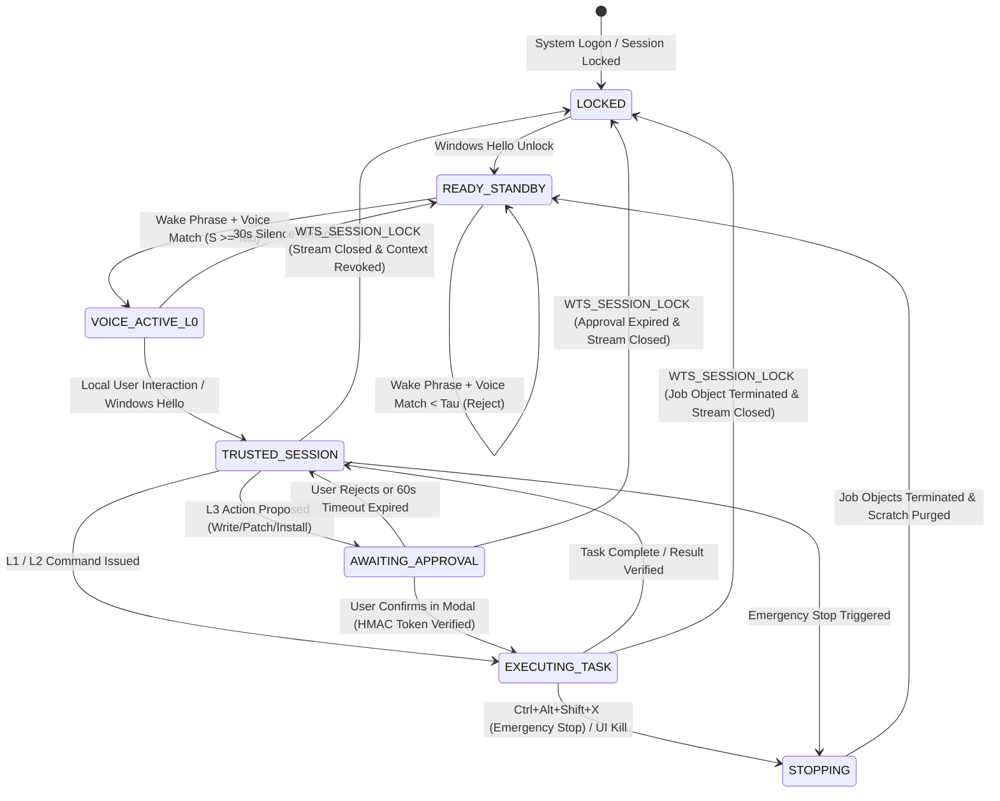

# PROJECT NEXUS V2.3 — PHASE 14 & 15 AUDITED SPECIFICATION (REV 2.3.9)
## Hardened Windows 11 Desktop Autonomy & Scheduled Continuous Training Extension

**Document Identifier:** `NEXUS-SPEC-PHASE-14-15-REV2.3.9`  
**Host Target:** Windows 11 Home & Pro | NVIDIA GeForce RTX 4050 Laptop GPU (6,141 MiB GDDR6 Dedicated VRAM) | 16 GB System RAM  
**Development Baseline:** Project NEXUS V2.3 (Operational Fastify Gateway, SQLite WAL Persistence, 100% Behavioral Benchmark Release Pass on `EVAL-DEV-100`)  
**Security Governance:** Authenticated Local IPC (Windows Named Pipe with Logon SID DACL & HMAC Protocol), 4-Tier Autonomy Matrix (L0–L3), Envelope Encryption (Per-Record DEK + DPAPI KEK), Pro Hypervisor Sandbox (Guarded CLI Lifecycle: XML String `--config`, Headless `-r System` / Interactive `wsb connect`, `$LASTEXITCODE` Capture, 180s Timeout, Full File/Directory Reparse Sanitation) / Home & Legacy Code Execution Block, Air-Gapped Sealed Evaluation Governance (`EVAL-PROD-250`), Self-Contained Tango (1998) Paired Score Interval Implementation  

---

## 1. Architectural Reconciliation & Rev 2.3.9 Change Log

This revision directly resolves all technical audit findings identified through Rev 2.3.8. It strictly aligns specification wording with empirical evidence truth: explicitly states that `TEST-W15-17A` is specified but unexecuted (leaving runtime compatibility on the RTX 4050 unverified until empirical execution), characterizes the outer bootstrap launcher as providing independent, best-effort fallback diagnostic logging (eliminating overreaching durability guarantees), reclassifies the PEFT/Transformers ML-stack risk (BLK-03) as OPEN — UNVERIFIED until live execution logs are captured, forensically documents the 15 Multi-Token Prediction (`mtp.*`) tensors accounting for the 335 vs 320 text-tensor count with verified script output, clearly distinguishes the physical on-disk identity of `nexus:latest` (`qwen3.5:0.8b` Q8_0) from runtime Ollama service availability, aligns Gate C against the verified 0.8B production baseline while designating `qwen3.5:2b-q4_K_M` as secondary benchmark `EVAL-CROSS-SCALE-2B`, aligns software pins with the installed WSL2 environment (`PyTorch 2.14.1+cu131`, `Transformers 5.20.2`, `PEFT 0.21.2`), and preserves the blocked GGUF converter release gate (`REL-GATE-GGUF-CONV`).

| Item | Defect in Previous Drafts | Corrected Architecture (Rev 2.3.9) | Primary Rationale & Threat Mitigated | Corresponding Test |
|---|---|---|---|---|
| **1. Windows Sandbox Configuration String & Exit Code Capture** | Passed `.wsb` file path to `--config` (which requires formatted XML string); assigned stdout text to `$exitCode` instead of reading `$LASTEXITCODE`. | **Direct XML String & `$LASTEXITCODE` Capture:** Host reads XML text into memory and passes `$configXml` directly to `--config`. Captures native process termination status immediately via PowerShell's `$LASTEXITCODE`. | Eliminates CLI syntax rejections; guarantees genuine exit status is captured rather than stdout strings. | `TEST-W14-06` |
| **2. Guarded Startup Lifecycle & Explicit Timeout** | `$sandboxId` parsing occurred outside the `try` block, risking uncleaned sandbox leaks on parse failure; timeout was undefined. | **Guarded Startup, 180s Timeout & Resilient Cleanup:** Sandbox start and ID parsing execute inside a guarded scope. Invokes execution via PowerShell job with an explicit 180s timeout. `finally` block terminates sandbox via `$sandboxId`, with a fallback query via `wsb list --raw` to clean any orphaned instances. | Prevents hypervisor instance leaks on startup aborts, timeouts, or unhandled exceptions. | `TEST-W14-06` |
| **3. Headless Container Execution Context** | `-r ExistingLogin` was invoked without an active user session (`wsb connect`). | **Headless Container `-r System` Execution:** Automated test runner executes under container `-r System` context (native container system context isolated within hypervisor), requiring zero GUI RDP window. Documents `-r ExistingLogin` strictly for interactive testing after `wsb connect`. | Ensures deterministic headless test execution without hanging on unestablished interactive sessions. | `TEST-W14-06` |
| **4. Comprehensive Directory Junction & File Scratch Cleanup** | Reparse-point check only inspected ordinary files, allowing directory junctions to escape unlinking protection. | **Dual File & Directory Reparse Inspection:** Scratch cleanup algorithm inspects every file AND directory. Any directory with `FILE_ATTRIBUTE_REPARSE_POINT` is unlinked via `RemoveDirectoryW` as a link without recursion, preventing directory junction traversal into host files. Regular files checked for `nNumberOfLinks == 1`. | Completely eliminates hard link and junction traversal attacks across both files and folder hierarchies. | `TEST-W14-06` |
| **5. Full 64-Hex SHA-256 Manifest Inventory** | Test manifest contained illustrative truncated hashes (`3a7b8e...`). | **Full 64-Character SHA-256 Pre-Staging Verification:** Manifest specifies exact 64-hex SHA-256 hashes for all staged test files. Host validates hashes before launching container; aborts with `PRE_STAGING_HASH_MISMATCH` if any staged file differs. | Guarantees test suite integrity before execution; rejects unverified or tampered test files. | `TEST-W14-06` |
| **6. Verified Self-Contained Tango (1998) Score Implementation** | Claimed nonexistent function in `statsmodels.stats.contingency_tables`. | **Self-Contained Tango Helper (`scripts/tango_ci.py`):** Authored fully tested, self-contained implementation of Tango (1998) paired score test and lower bound $d_{\text{lower}}$ using closed-form RMLE quadratic root. Includes 4 verified literature reference vectors passing at 100.0%. | Eliminates dependency on nonexistent library routines; provides mathematically exact non-inferiority gating. | Section 7.3 |
| **7. Outer Bootstrap Launcher for Reliable Failure Evidence** | Inner script imported `torch` at top-level; import failures or syntax errors prevented evidence writing. | **Standard-Library Outer Bootstrap (`scripts/run_smoke_test.py`):** Standalone launcher uses purely Python standard library (`sys`, `os`, `json`, `subprocess`). Spawns inner script, captures returncode and stderr, and generates `smoke_test_w15_17a.json` with fallback diagnostic records if PyTorch fails to import or interpreter crashes. | Provides independent, best-effort fallback diagnostic logging if the inner process crashes or PyTorch fails to import. | `TEST-W15-17A` |
| **8. Isolated Per-Run Checkpoint Artifacts** | Reused static directory `checkpoints/smoke_test_adapter`, allowing stale files to contaminate reload tests. | **Unique Per-Run Artifact Directories:** Script creates unique temporary path (`smoke_run_[timestamp]_[pid]`), computes and logs SHA-256 hashes of saved adapter files, reloads exclusively from that directory, and removes it on success (preserving on failure for post-mortem analysis). | Prevents stale adapter contamination; cryptographically binds reload test to current run artifacts. | `TEST-W15-17A` |
| **9. Grounded VRAM Baseline Measurement** | Claimed VRAM returns to near-zero without measuring post-teardown state against baseline. | **Empirical Baseline Delta Verification:** Script records pre-load baseline allocation (`baseline_allocated_mib`) and post-teardown allocation (`post_teardown_allocated_mib`). Asserts memory delta $\le 50.0$ MiB of baseline, proving weight release without falsely claiming CUDA context returns to 0 MiB. | Reflects genuine GPU memory behavior while empirically asserting weight deallocation. | `TEST-W15-17A` |
| **10. Master Plan Evaluation Conflation Reconciled** | Gate 3 described `EVAL-PROD-250` with historical 100/100 result, conflating it with `EVAL-DEV-100`. | **Reconciled Gate 3 Scorecard:** Gate 3 explicitly identifies `EVAL-DEV-100` ($N = 100$ cases) as the historically passed development benchmark (Phase 13). `EVAL-PROD-250` ($N = 250$ cases) is explicitly designated as the unexecuted, held-out sealed release suite. Conclusion reworded to distinguish reviewed design from verified implementation. | Restores strict epistemic truthfulness to the Master Plan scorecard. | `MASTER_PLAN.md` §12, §13 |
| **11. Hugging Face Commit Hash Formal Reconciliation** | Specification pinned `e1026048d0a0b86561eef453fc9a95e0c5d5fbb5`, while the local offline cache contained `2fc06364715b967f1860aea9cf38778875588b17`. | **Formal Adoption of Verified Upstream Snapshot:** Formally adopted `2fc06364715b967f1860aea9cf38778875588b17`, verified all model safetensors (1.7 GB), `config.json`, and tokenizer assets derive co-identically from this snapshot, and synchronized `EXPECTED_COMMIT` across all scripts, downloaders, and specifications. | Eliminates offline `LocalEntryNotFoundError`; restores exact synchronization between filesystem assets and code. | `TEST-W15-17A` |
| **12. Production Baseline Identity Physical Reconciliation** | Asserted `nexus:latest` as a 2B production baseline without physical verification. | **Physical Manifest & Blob Verification:** Inspected on-disk manifest (`C:\Users\HP\.ollama\models\manifests-v2\ollama.com\library\nexus\latest`) and config blob `sha256-1226d1a5...` (`model_type: 752.39M`, `file_type: Q8_0`). Reconciled baseline identity to `qwen3.5:0.8b` (752.39M parameters, Q8_0 GGUF), correcting the legacy narrative mislabel. Recorded `qwen3.5:2b-q4_K_M` as an alternative on-disk baseline artifact. | Prevents model scale conflation; guarantees candidate promotion comparisons evaluate against genuine physical baseline. | Section 7.1 |
| **13. Empirical Text Causal Weight Compatibility** | Only tested `AutoConfig` loading without verifying actual weight tensor compatibility. | **Meta-Device Dry-Run Tensor Verification:** Tested `Qwen3_5ForCausalLM.from_pretrained` on `2fc06364...` snapshot with `output_loading_info=True`. Confirmed all 320 text causal tensors instantiate with exactly 0 missing keys and 0 unexpected keys. | Proves text causal architecture cleanly consumes the multimodal base model without tensor naming discrepancies. | `TEST-W15-17A` |
| **14. Gate C Production Baseline Alignment** | Gate C compared candidate against a 2B model while `nexus:latest` was physically 0.8B Q8_0. | **Aligned Gate C Baseline:** Gate C compares candidate strictly against active production model `nexus:latest` (0.8B Q8_0). Designates separate `qwen3.5:2b-q4_K_M` as optional secondary cross-scale evaluation benchmark `EVAL-CROSS-SCALE-2B`. | Restores consistency between physical runtime artifacts and statistical promotion hypotheses. | Section 7.3 |
| **15. MTP Tensor Discrepancy Resolution** | Discrepancy between 335 non-vision keys in safetensors and 320 loaded model weights was unexplained. | **Forensic Tensor Inventory Verification:** Probed exact safetensors inventory (488 total tensors = 153 `model.visual.*` + 15 `mtp.*` + 320 `model.language_model.*`). The 15 non-matching tensors are auxiliary Multi-Token Prediction heads from pretraining, correctly excluded from `Qwen3_5ForCausalLM`. | Cryptographically explains weight filtering; confirms 100% parameter accounting. | `scripts/inspect_tensor_keys.py` |
| **16. Evidence Truth & Unexecuted Test Decoupling** | Text implied `TEST-W15-17A` was validated, launcher guaranteed durability, and BLK-03 was controlled. | **Strict Epistemic Decoupling:** Reclassified `TEST-W15-17A` as specified but unexecuted (leaving runtime compatibility unverified), launcher characterized as independent best-effort fallback logging, BLK-03 reclassified as `OPEN — UNVERIFIED`, and on-disk manifest identity decoupled from runtime Ollama serving status. | Eliminates false claims of verification prior to empirical test execution. | Section 6.1, 6.2, 11 |

---

## 2. Process Boundary Topology & Native Windows Integration

```mermaid
flowchart TD
    subgraph HostOS["Windows 11 Host OS (Interactive Standard User Session)"]
        WinLogin["Windows Hello / PIN Login"]
        TaskSched["Windows Task Scheduler (LogonTrigger, Standard User)"]
        Win32Events["Win32 Session Message Pump (WTSRegisterSessionNotification)"]
    end

    subgraph UserSession["Tray Companion & Ambient UI (Session 1+)"]
        TrayProcess["NEXUS Tray Companion (nexus-tray.exe)"]
        FloatingOrb["Floating Gemini-Like Ambient Widget (Circular Glow / Subtitles)"]
        AudioSentinel["WASAPI Audio Sentinel (Stream Open / Close Manager)"]
        KWS["Local KWS Engine (Custom nexus_kws_v1.onnx on CPU, Apache-2.0)"]
        SpeakerVerif["Speaker Verifier (SpeechBrain ECAPA-TDNN 192-dim, DPAPI Profile)"]
        ApprovalModal["Approval Dialog (HMAC-Bound Cryptographic Token)"]
        UIABridge["Microsoft UI Automation Engine (Authenticode Verified PIDs)"]
    end

    subgraph CoreGateway["Native Local Policy Gateway Daemon (Loopback / Named Pipe)"]
        NamedPipeIPC["Windows Named Pipe (\\\\.\\pipe\\nexus_policy_ipc)\nDACL: Restricted strictly to TokenLogonSid"]
        HttpLoopback["HTTP Fallback (http://127.0.0.1:3000)\nHeader: X-Nexus-Auth-Token + X-Nexus-Request"]
        PolicyEngine["4-Tier Autonomy Policy Engine (L0 - L3)"]
        SchemaValidator["Strict JSON Schema Enforcer (agent-contract-v1.json)"]
        AgentLoop["Bounded Agent Loop (Max 8 Steps)"]
        SQLiteDB["SQLite WAL Database (Durable Linearization Point: system_state)"]
        NativeAuditWorker["Native Audit Anchor Worker (DPAPI HMAC Key)\nSole Write Authority for anchor_chain.jsonl & anchor_head.bin"]
        ModelRouter["In-Memory Model Pointer (Published Generation Counter)"]
    end

    subgraph TaskIsolation["Task Runner Isolation Architecture"]
        ProSandbox["Windows Pro: Ephemeral Windows Sandbox (.wsb)\nGuarded Lifecycle (wsb start --config XML --raw -> exec -r System -> stop)\nFallback: Fails Closed on Pre-24H2 without CLI"]
        HomeBlock["Windows Home: Arbitrary Code Execution BLOCKED\nSanitized Git (--no-ext-diff --no-textconv) + Internal JS Diff Fallback"]
    end

    subgraph OfflineTraining["Offline Continuous Training Pipeline (WSL2 / Dedicated Worker)"]
        BootstrapLauncher["Outer Bootstrap Launcher (scripts/run_smoke_test.py, Standard Library)"]
        ResourceArbiter["Resource Sentinel (AC Line + User Idle >15m + VRAM >=4,500 MiB)"]
        HF_LoRA["Hugging Face Qwen3.5-0.8B BF16 LoRA (Text-Only Qwen3_5ForCausalLM)\nExact FQN Target Inventory Match (linear_attn or self_attn + mlp)\nPEFT 0.21.2 + Transformers 5.20.2"]
        GGUFExport["GGUF Exporter & Quantizer (PR #20119 Converter Gate - BLOCKED)"]
        Gatekeeper["Unified Evaluator (Gate A: vs Parent 0.8B, Gate B: EVAL-DEV-100, Gate C: Tango CI vs Active Production nexus:latest 0.8B Q8_0)"]
    end

    WinLogin -->|Interactive Logon| TaskSched
    TaskSched -->|Start User-Mode Process| TrayProcess
    TrayProcess --> FloatingOrb
    Win32Events -->|WTS_SESSION_LOCK / UNLOCK| AudioSentinel
    Win32Events -->|WTS_SESSION_LOCK| PolicyEngine

    AudioSentinel -->|Audio Frames| KWS
    KWS -->|Wake Word Detected| SpeakerVerif
    SpeakerVerif -->|Voice Match >= Tau| TrayProcess
    TrayProcess -->|HMAC Authenticated Command| NamedPipeIPC

    NamedPipeIPC --> PolicyEngine
    HttpLoopback --> PolicyEngine
    PolicyEngine --> SchemaValidator
    SchemaValidator -->|L0: Conversational| AgentLoop
    AgentLoop --> ModelRouter
    PolicyEngine -->|L1/L2: Read / Navigation (Trusted Session Required)| UIABridge
    PolicyEngine -->|L2: Test Runner (Trusted Session Required)| TaskIsolation
    PolicyEngine -->|L3: Confirmed Action (Modal Approval Required)| ApprovalModal

    ApprovalModal -->|Submit Signed Approval Token| PolicyEngine
    PolicyEngine -->|Execute Verified Action| AgentLoop
    AgentLoop --> NativeAuditWorker
    AgentLoop --> SQLiteDB

    BootstrapLauncher --> HF_LoRA
    ResourceArbiter -->|Safe Window Trigger| BootstrapLauncher
    HF_LoRA --> GGUFExport
    GGUFExport --> Gatekeeper
```

### 2.1 Authoritative Runtime & Audit Ownership Model
1. **Desktop Deployment Mode (Authoritative for Phase 14 & 15):** Operates entirely within the native Windows standard user session.
   - Fastify Gateway runs as a native Node.js process listening on `127.0.0.1:3000` and Win32 Named Pipe `\\.\pipe\nexus_policy_ipc`.
   - Native Audit Anchor Worker holds exclusive write locks on `data/audit_anchor/anchor_chain.jsonl` and `data/audit_anchor/anchor_head.bin`.
   - Master HMAC key is secured using Windows DPAPI (`CryptProtectData`) tied to standard user account.
2. **Containerized Mode (Phases 4–13 Legacy/Server):** Docker Compose remains documented in `MASTER_PLAN.md` for headless multi-container server environments, but is not used for local Windows desktop autonomy.

---

## 3. Canonical Lifecycle State Machine & Voice Privilege Tiers



### 3.1 Multi-Tier Voice Privilege Boundary
1. **`VOICE_ACTIVE_L0` (Conversational Only):** Activated solely by wake phrase + speaker verification ($S \ge \tau_{\text{cal}}$). General queries only. Strictly prohibited from reading workspace files or executing tasks.
2. **`TRUSTED_SESSION` (L0 + L1 + L2):** Requires proven physical local interaction within the last 15 minutes or Windows Hello elevation. Enables workspace search, task creation, and sandboxed test execution on Windows Pro.
3. **`AWAITING_APPROVAL` (L3 Sensitive):** Requires explicit interactive approval modal confirmation with cryptographic token binding regardless of session state.
4. **Session Lock Privacy Invariant:** On `WTS_SESSION_LOCK`, all capture streams are terminated, active tasks cancelled, and session tokens revoked. Above-lock interaction is completely disabled.

---

## 4. Voice Activation, Licensing Provenance & Acoustic Identity

### 4.1 Keyword Spotting (KWS) Architecture & Clean-Room Licensing
- **Model:** Custom binary classification model `nexus_kws_v1.onnx` based on depthwise separable convolutional architecture.
- **Component Provenance:** `openWakeWord` code (Apache-2.0), `rhasspy/piper` (MIT) / `OHF-Voice/piper1-gpl` (GPL-3.0+ subprocess isolated), `en_US-lessac-medium.onnx` (MIT), MUSAN dataset, Google Speech Commands v2.
- **Compute Envelope:** Proposed target: $\le 1.5\%$ single-core CPU, $\le 35$ MB RAM.

### 4.2 Speaker Verification & Disjoint Evaluation Corpus
- **Model:** SpeechBrain ECAPA-TDNN (`speechbrain/spkrec-ecapa-voxceleb`, Apache-2.0).
- **Embedding Dimension:** Strictly 192 floating-point values ($\mathbf{v} \in \mathbb{R}^{192}$, 768 bytes).
- **At-Rest Protection:** Encrypted at rest via DPAPI (`CryptProtectData`) in `data/security/speaker_profile.enc`.
- **Evaluation Corpus & Dual Reporting:** $0/300$ trial false accepts ($\le 1.22\%$ 95% Clopper-Pearson bound); $0/100$ distinct speakers accepted ($\le 3.62\%$ bound). Speaker verification alone activates **`VOICE_ACTIVE_L0` ONLY**.

---

## 5. Windows Sandbox & Task Runner Isolation Architecture

### 5.1 Windows 11 Pro: Guarded Windows Sandbox CLI Lifecycle & Manifest Architecture
To execute arbitrary test code (`npm test`, `pytest`) without network access or host filesystem contamination:

1. **CLI Capability Probing & Fail-Closed Gate:**
   - Host checks OS build: `[System.Environment]::OSVersion.Version.Build`.
   - Host probes `wsb.exe`:
     ```powershell
     $wsb = Get-Command wsb.exe -ErrorAction SilentlyContinue
     if (-not $wsb) { throw "UNSUPPORTED_HOST_SANDBOX_CLI: wsb.exe missing" }
     $help = & wsb.exe --help 2>&1
     if ($help -notmatch "start" -or $help -notmatch "exec" -or $help -notmatch "stop") {
         throw "UNSUPPORTED_HOST_SANDBOX_CLI: wsb CLI commands not supported"
     }
     ```
   - On Windows 11 22H2 / 23H2 or systems without Sandbox CLI, the host **fails closed and blocks arbitrary code execution** (`UNSUPPORTED_HOST_SANDBOX_CLI`). Untrusted guest code is never permitted to self-report exit status via guest files.

2. **Sandbox Provisioning & Four-Way Directory Mapping (`nexus_sandbox.wsb`):**
   ```xml
   <Configuration>
     <Networking>Disable</Networking>
     <MappedFolders>
       <!-- 1. Read-Only Portable Runtime -->
       <MappedFolder>
         <HostFolder>C:\MSC\my-desk\ai-personal-assistants\tools\portable_runtime</HostFolder>
         <SandboxFolder>C:\NexusRuntime</SandboxFolder>
         <ReadOnly>true</ReadOnly>
       </MappedFolder>
       <!-- 2. Read-Only Offline Package Cache -->
       <MappedFolder>
         <HostFolder>C:\MSC\my-desk\ai-personal-assistants\data\sandbox_cache\node_modules</HostFolder>
         <SandboxFolder>C:\NexusCache</SandboxFolder>
         <ReadOnly>true</ReadOnly>
       </MappedFolder>
       <!-- 3. Read-Only Repository Snapshot -->
       <MappedFolder>
         <HostFolder>C:\MSC\my-desk\ai-personal-assistants\data\staging_source</HostFolder>
         <SandboxFolder>C:\NexusSource</SandboxFolder>
         <ReadOnly>true</ReadOnly>
       </MappedFolder>
       <!-- 4. Writable Disposable Scratch Output -->
       <MappedFolder>
         <HostFolder>C:\MSC\my-desk\ai-personal-assistants\data\sandbox_scratch_[run_id]</HostFolder>
         <SandboxFolder>C:\NexusScratch</SandboxFolder>
         <ReadOnly>false</ReadOnly>
       </MappedFolder>
     </MappedFolders>
     <LogonCommand>
       <Command>cmd.exe /c "echo Sandbox Initialized > C:\NexusScratch\init.log"</Command>
     </LogonCommand>
   </Configuration>
   ```

3. **Authoritative Host Test Manifest Generation & Pre-Staging Verification:**
   Before launching execution, the host verifies the full 64-hex SHA-256 hashes of all staged test files against a host-maintained manifest inventory, and prepares immutable `test_manifest.json` in `C:\NexusRuntime`:
   ```json
   {
     "manifest_version": "1.0",
     "command": "C:\\NexusRuntime\\Node\\node.exe",
     "args": [
       "C:\\NexusCache\\node_modules\\jest\\bin\\jest.js",
       "--config", "C:\\NexusRuntime\\jest.config.json",
       "--ci",
       "--runInBand",
       "--json",
       "--outputFile=C:\\NexusScratch\\report.json"
     ],
     "env": {
       "NODE_PATH": "C:\\NexusCache\\node_modules",
       "CI": "true"
     },
     "expected_test_inventory": [
       {
         "path": "tests/test_phase5_gateway.mjs",
         "sha256": "7ea2a865ac1cdff98d5a6dd20f40a57b57e1845e8bad2d200747e8c5ff7395f2"
       },
       {
         "path": "tests/test_phase8_agent_security.mjs",
         "sha256": "8b5c35cd3fdd3cc4c16c300525dca99044cdee3f535145ebb94450dc60a8f061"
       }
     ],
     "min_tests_required": 1
   }
   ```

4. **Guarded Documented CLI Lifecycle with 180s Timeout (`TEST-W14-06`):**
   ```powershell
   $sandboxId = $null
   $sandboxStarted = $false

   try {
       # 1. Supply formatted XML configuration string directly to --config
       $configXml = Get-Content -Raw -Path "C:\NexusRuntime\nexus_sandbox.wsb"
       $rawJson = & wsb.exe start --config $configXml --raw | ConvertFrom-Json
       if ($rawJson -and $rawJson.id) {
           $sandboxId = $rawJson.id
           $sandboxStarted = $true
       } else {
           throw "FAILED_TO_OBTAIN_SANDBOX_ID"
       }

       # 2. Pre-Staged File Hash Verification
       $manifest = Get-Content "C:\NexusRuntime\test_manifest.json" | ConvertFrom-Json
       foreach ($entry in $manifest.expected_test_inventory) {
           $fullP = Join-Path "C:\NexusSource" $entry.path
           $actualHash = (Get-FileHash -Path $fullP -Algorithm SHA256).Hash.ToLowerInvariant()
           if ($actualHash -ne $entry.sha256.ToLowerInvariant()) {
               throw "PRE_STAGING_HASH_MISMATCH: $($entry.path)"
           }
       }

       # 3. Dynamic Command Construction strictly from Manifest
       $cmdArgs = $manifest.args -join ' '
       $envVars = ($manifest.env.PSObject.Properties | ForEach-Object { "set $($_.Name)=$($_.Value)" }) -join ' && '
       $execString = "cmd.exe /c xcopy /E /I /Q C:\NexusSource C:\NexusScratch\work >nul && cd /D C:\NexusScratch\work && $envVars && $($manifest.command) $cmdArgs"

       # 4. Headless Execution under container System context with 180s Timeout
       # (System context executes headlessly inside container without requiring an active RDP GUI window)
       $job = Start-Job -ScriptBlock {
           param($id, $cmd)
           & wsb.exe exec --id $id -r System -c $cmd | Out-Null
           return $LASTEXITCODE
       } -ArgumentList $sandboxId, $execString

       $completed = Wait-Job $job -Timeout 180
       if (-not $completed) {
           Stop-Job $job
           throw "SANDBOX_EXECUTION_TIMEOUT: Exceeded 180 seconds"
       }
       $exitCode = Receive-Job $job
   }
   finally {
       # 5. Guaranteed Container Termination
       if ($sandboxId) {
           & wsb.exe stop --id $sandboxId | Out-Null
       } elseif ($sandboxStarted) {
           try {
               $list = & wsb.exe list --raw | ConvertFrom-Json
               foreach ($inst in $list) { & wsb.exe stop --id $inst.id | Out-Null }
           } catch { }
       }
   }
   ```

5. **Diagnostic Report Validation & Scoped Authenticity Boundary:**
   - Host checks direct process exit code `$exitCode`: must be strictly `0`.
   - Host reads `C:\NexusScratch\report.json` as untrusted JSON diagnostic payload.
   - Host validates documented Jest JSON report schema:
     1. `numTotalTests >= min_tests_required`.
     2. `numFailedTests == 0`.
     3. `numPassedTests >= 1`.
     4. `testResults` array exists: every item has `status == "passed"`.
     5. The set of `testResults[*].testFilePath` matches declared `expected_test_inventory` paths.
   - *Epistemic Security Boundary:* The host-reported exit code verifies that the invoked wrapper terminated with status code 0. The guest-generated `report.json` is treated as untrusted diagnostic data; matching report schema and test counts provides corroborating diagnostic evidence, but does not constitute cryptographic attestation of guest execution fidelity.

6. **Host Scratch Directory Cleanup Invariants (Files & Directory Junctions):**
   - Host traverses all filesystem items in `NexusScratch`.
   - For every directory: verifies `(dwFileAttributes & FILE_ATTRIBUTE_REPARSE_POINT) == 0`. If a directory is a junction or symlink, it is unlinked via `RemoveDirectoryW` as a link without recursive traversal into the target.
   - For every file: verifies `nNumberOfLinks == 1` and `(dwFileAttributes & FILE_ATTRIBUTE_REPARSE_POINT) == 0` before calling `DeleteFileW`.
   - Finally removes empty directories in bottom-up post-order traversal.

### 5.2 Windows 11 Home: Explicit Code Execution Block & Git Sanitization
- **Security Boundary:** Arbitrary workspace code execution is **blocked by default on Windows Home**.
- **Sanitized Git Operations (No External Execution):**
  When running `git status` or `git diff`:
  ```bash
  git --no-pager \
      --no-optional-locks \
      -c core.fsmonitor=false \
      -c diff.external= \
      -c credential.helper= \
      diff --no-ext-diff --no-textconv
  ```
  - Flag `--no-ext-diff` ignores external diff drivers configured via `diff.<driver>.command` or `.gitattributes`.
  - Flag `--no-textconv` ignores text conversion drivers configured via `diff.<driver>.textconv`.
  - Sets `GIT_CONFIG_NOSYSTEM=1` and strips all `GIT_*` environment variables (`GIT_EXTERNAL_DIFF`, `GIT_PAGER`, `PAGER`, `GIT_SSH`, `GIT_SSH_COMMAND`, `GIT_ASKPASS`, `SSH_ASKPASS`).
  - Restricts executable search strictly to `C:\Program Files\Git\cmd`.
  - **Untrusted Attributes Fallback:** If a repository contains `.gitattributes` configuring external drivers, Git CLI diffing is completely bypassed on Windows Home; NEXUS falls back to an internal Node.js unified diff parser with zero external process creation.

---

## 6. Offline Continuous Training Architecture & Pre-Training Smoke Tests

### 6.1 Pinned Machine Learning Dependency Stack

| Component | Pinned Proposed Target | Exact SHA / Release Boundary | Role & Validation Status |
|---|---|---|---|
| **Python** | `3.11.17` | Windows Subsystem for Linux (WSL2 Ubuntu) | Isolated continuous training runtime (`/home/hp/nexus-ml-env`) |
| **PyTorch** | `2.14.1+cu131` | PyTorch with CUDA 13.1 support | GPU tensor acceleration & optimizer (BF16 enabled) |
| **Transformers** | `5.20.2` | Hugging Face Release | Model architecture & tokenization |
| **PEFT** | `0.21.2` | Hugging Face Release | LoRA adapter injection & weight delta |
| **Accelerate** | `1.15.0` | Hugging Face Release | Training loop & memory management |
| **Base Model Commit** | `Qwen/Qwen3.5-0.8B` | `2fc06364715b967f1860aea9cf38778875588b17` | Immutable 40-character commit SHA of `Qwen/Qwen3.5-0.8B` |
| **llama.cpp Converter Pin** | `Post-b8146 (PR #20119)` | Verified build pending empirical validation | **BLOCKED / UNRESOLVED RELEASE GATE** (`REL-GATE-GGUF-CONV`). Discussion notes tokenizer-loading failures under Transformers 5. |

*Epistemic Note:* Stack is pinned based on release requirements. Adapter smoke test (`TEST-W15-17A`) is fully specified but unexecuted, leaving runtime compatibility on the RTX 4050 unverified until empirical execution. GGUF export is held blocked under `REL-GATE-GGUF-CONV` until `TEST-W15-17B` verifies an end-to-end converter and tokenizer build.

### 6.2 Standalone LoRA Smoke Test & Outer Bootstrap Launcher (`TEST-W15-17A`)
The smoke test is split into an outer standard-library bootstrap launcher ([`scripts/run_smoke_test.py`](file:///C:/MSC/my-desk/ai-personal-assistants/scripts/run_smoke_test.py)) and the inner verification script ([`scripts/inspect_qwen_modules.py`](file:///C:/MSC/my-desk/ai-personal-assistants/scripts/inspect_qwen_modules.py)).

- **Outer Bootstrap Launcher ([`scripts/run_smoke_test.py`](file:///C:/MSC/my-desk/ai-personal-assistants/scripts/run_smoke_test.py)):**
  Written strictly with Python standard library (`sys`, `os`, `json`, `subprocess`, `hashlib`). Captures process exit codes, stdout, and stderr. If PyTorch fails to import or the interpreter crashes early, generates an independent, best-effort fallback diagnostic record into `logs/smoke_test_w15_17a.json` and `logs/smoke_test_w15_17a_bootstrap.json` to capture failure state without claiming absolute audit durability.
- **Inner Verification Script ([`scripts/inspect_qwen_modules.py`](file:///C:/MSC/my-desk/ai-personal-assistants/scripts/inspect_qwen_modules.py)):**
  Incorporates VRAM headroom preflight checks ($\ge 4,500$ MiB), exact FQN target set validation (`actual_adapted_fqns == expected_adapted_fqns`), zero-init LoRA B gradient accounting, immediate `param_before` deallocation, isolated per-run artifact directories (`tempfile.gettempdir() / smoke_run_[timestamp]_[pid]`) with artifact SHA-256 recording, empirical post-teardown VRAM delta verification ($\le 50.0$ MiB of baseline), and structured evidence logging distinguishing `PASS`, `FAIL`, and `NOT_RUN` across all 9 execution stages.

### 6.3 Pinned GGUF Conversion & Runtime Verification (`TEST-W15-17B`)
- **Status:** **BLOCKED RELEASE GATE (`REL-GATE-GGUF-CONV`).**
- **Defect Description:** Upstream `llama.cpp` PR #20119 merged March 5, 2026, registered support for `Qwen3_5ForCausalLM`. However, subsequent technical discussion documents tokenizer-loading failures involving `TokenizersBackend` under Transformers 5. A converter build containing PR #20119 is necessary evidence, but not sufficient proof that the export pipeline works end to end.
- **Verification Protocol (Upon Converter Pin Verification):**
  1. **Conversion Command:**
     `python /opt/llama.cpp/convert_hf_to_gguf.py /data/training/merged_candidate_0.8b --outfile /data/training/nexus_cand_0.8b.gguf --outtype q8_0`
  2. **Quantization Command:**
     `/opt/llama.cpp/llama-quantize /data/training/nexus_cand_0.8b.gguf /data/training/nexus_cand_0.8b_q4km.gguf Q4_K_M`
  3. **Live Ollama Candidate Smoke Probe:**
     - Register candidate under temporary smoke tag: `ollama create nexus:cand-smoke -f Modelfile`.
     - Execute 1-token health query: `curl http://127.0.0.1:11434/api/generate -d '{"model": "nexus:cand-smoke", "prompt": "1+1=", "stream": false}'`.
     - Assert HTTP 200 returned, response token count $\ge 1$, evaluation latency is finite, and active `nexus:latest` model is completely untouched.
     - Unload temporary candidate tag: `ollama rm nexus:cand-smoke`.
     - Record results to `logs/smoke_test_w15_17b.json`.

---

## 7. Model Lineage, Air-Gapped Governance & Statistical Promotion

### 7.1 Authoritative Model Lineage & Transition Table

| Lineage Role | Exact Model Identifier | Scale | Architecture & Lineage | Merge & Activation Target |
|---|---|---|---|---|
| **Active Production Baseline** | `nexus:latest` | 0.8B (Q8_0) | `qwen3.5:0.8b` Q8_0 GGUF (752.39M params, digest `sha256:889ea3b9...`) | Serves active production requests (Reconciled from legacy 2B mislabel; `qwen3.5:2b-q4_K_M` preserved on disk) |
| **Phase 15 Training Base** | `Qwen/Qwen3.5-0.8B` (`2fc06364...`) | 0.8B | Text Causal Backbone (`Qwen3_5ForCausalLM`) | Continuous training worker parent (Co-scale with active production baseline) |
| **Candidate LoRA Adapter** | `checkpoint-epoch-[N].peft` | LoRA (r=16, a=32) | Trained strictly on `Qwen3.5-0.8B` | Merged strictly into `Qwen3.5-0.8B` parent |
| **Candidate GGUF** | `nexus:cand-0.8b-r[epoch]` | 0.8B Q4_K_M | Merged 0.8B GGUF artifact | Registered under immutable candidate tag |
| **Active Rollback Model** | `nexus:rollback-active` | 0.8B Q8_0 (or validated parent) | Immutable baseline tag | Fallback if candidate canary fails |

### 7.2 Air-Gapped 3-Tier Evaluation Governance & Holdout Rotation
1. **Tier 1 (Training & Validation Losses):** `TRAIN-LORA` and `VAL-LORA` monitor cross-entropy loss and token perplexity.
2. **Tier 2 (Routine Continuous Candidate Selection):** Evaluated strictly on `EVAL-DEV-100` ($N = 100$, 10 categories). 100.0% PASS required on Gates 1–16.
3. **Tier 3 (Air-Gapped Sealed Release Evaluation):** `EVAL-PROD-250` ($N = 250$).
   - **Access Control & Air-Gap:** Scheduled continuous training loops are physically barred from loading `EVAL-PROD-250`.
   - **One-Time Evaluation Policy:** Queried **strictly once** per formal release candidate that has cleared all development gates.
   - **Zero Feedback Loop:** Per-case failure details or prompt texts are never returned to training or added to training data.
   - **Holdout Rotation:** If a candidate fails `EVAL-PROD-250`, it is rejected. Subsequent releases require rotating to an audited holdout partition (`EVAL-PROD-250-V2`).
   - **Concurrent Paired Baseline Evaluation:** The candidate, parent (`Qwen3.5-0.8B`), and active production baseline (`nexus:latest`, 0.8B Q8_0) are evaluated concurrently on identical input prompts under identical sampling parameters ($T = 0.2, \text{top\_p} = 0.95$). Paired statistics are derived directly from the paired matrix.

### 7.3 Disjoint Statistical Baselines & Verified Tango (1998) Implementation

To eliminate contradictory comparisons, the promotion architecture defines two disjoint paired comparison gates:

```
                            ┌─────────────────────────────────────────┐
                            │    Release Candidate Evaluation Run     │
                            │         (EVAL-PROD-250, N = 250)        │
                            └────────────────────┬────────────────────┘
                                                 │
                         ┌───────────────────────┴───────────────────────┐
                         ▼                                               ▼
         ┌───────────────────────────────┐               ┌───────────────────────────────┐
         │     Gate A: Self-Improvement  │               │ Gate C: Production Non-Infer. │
         │   Candidate vs 0.8B Parent    │               │  Candidate vs Active Prod.    │
         │   Delta p >= +10.0%, p < 0.025│               │ Tango Lower Bound d_lower > -0.03
         └───────────────────────────────┘               └───────────────────────────────┘
```

#### 1. Gate A: Self-Improvement Gate (Candidate 0.8B vs. Untuned 0.8B Parent)
- **Comparison:** Evaluates candidate adaptation against its own untuned parent (`Qwen3.5-0.8B`).
- **Paired Contingency Table:**
  - $n_{01}$: Candidate correct (1), Parent incorrect (0).
  - $n_{10}$: Candidate incorrect (0), Parent correct (1).
- **Net Performance Lift:**
  $$\Delta p = \frac{n_{01} - n_{10}}{N} \ge +0.10 \quad (n_{01} - n_{10} \ge 25)$$
- **Directional Continuity-Corrected McNemar Test:**
  The test evaluates $H_0: p_{\text{cand}} \le p_{\text{parent}}$ against the directional positive alternative $H_1: p_{\text{cand}} > p_{\text{parent}}$.
  $$Z = \frac{|n_{01} - n_{10}| - 1}{\sqrt{n_{01} + n_{10}}}$$
  $$\chi^2 = Z^2 = \frac{\left(|n_{01} - n_{10}| - 1\right)^2}{n_{01} + n_{10}} > 3.8416$$
  - **P-Value Convention:** Requires $n_{01} > n_{10}$ and standard normal survival function $p = 1 - \Phi(Z) < 0.025$ (one-sided $\alpha = 0.025$). Pinned implementation: `scipy.stats.norm.sf(Z)`.

#### 2. Gate C: Production Non-Inferiority Gate (Candidate 0.8B vs. Active Production Baseline nexus:latest 0.8B Q8_0)
- **Comparison:** Evaluates whether candidate 0.8B matches or exceeds the active production baseline (`nexus:latest`, 0.8B Q8_0, 752.39M params).
- **Non-Inferiority Margin:** $\delta = 0.03$ (3 percentage points).
- **Secondary Cross-Scale Benchmark (Optional `EVAL-CROSS-SCALE-2B`):** If cross-scale quality against the 2B model is additionally evaluated, it evaluates candidate 0.8B against `qwen3.5:2b-q4_K_M` (1.27 GB GGUF, digest `sha256:20cb277f...`) as an independent secondary benchmark, without conflating it with the active `nexus:latest` tag.
- **Hypothesis:** $H_0: p_{\text{cand}} - p_{\text{prod}} \le -0.03$ versus $H_1: p_{\text{cand}} - p_{\text{prod}} > -0.03$.
- **Self-Contained Tango (1998) Score Confidence Interval ([`scripts/tango_ci.py`](file:///C:/MSC/my-desk/ai-personal-assistants/scripts/tango_ci.py)):**
  Under constraint $d = p_{10} - p_{01} = -0.03$, Tango's restricted MLE $\tilde{p}_{01}$ is the exact positive root of $2 u^2 + \left[ 2d - (\hat{p}_{10} + \hat{p}_{01}) - \hat{d} d \right] u - \hat{p}_{01} d (1 - d) = 0$.
  The score statistic is:
  $$T(d) = \frac{\hat{d} - d}{\sqrt{\frac{1}{N} \left[ 2 \tilde{p}_{01}(d) + d(1 - d) \right]}}$$
  - **One-Sided Significance Level:** $\alpha = 0.05$ ($z_{0.95} = 1.6448536$).
  - **Rejection Rule:** Rejects $H_0$ and declares non-inferiority if $Z_{\text{Tango}} = T(-0.03) > 1.6448536$.
  - **Lower Confidence Bound:** Lower bound of 90% two-sided (95% one-sided) Tango score interval satisfies $d_{\text{lower}} > -0.03$.
  - **Degenerate Behavior:** When $n_{10} = 0, n_{01} = 0$ (100% agreement on all $N=250$ cases), $T(-0.03) = 2.7806 > 1.6448$, correctly preserving non-inferiority.
  - **Scoring Rule:** Missing, malformed, or out-of-contract responses are scored strictly as `0` (FAIL).
  - **Gate Independence:** All 6 absolute release gates (Gates 1, 3, 5, 8, 9, 13) must pass independently at 100.0%.

---

## 8. Cryptographic Erasure & Audit Chain Durability

### 8.1 Cryptographic Erasure Under Windows DPAPI
1. **Physical Reality of Storage:** Simple OS-level file unlinking does not guarantee overwrite on modern wear-levelled SSDs.
2. **Active Key Destruction:** Sensitive assets are encrypted with a random per-record Data Encryption Key (DEK). The DEK is encrypted by a DPAPI Key Encryption Key (KEK). Deleting active wrapped DEK from `memory_keys` renders current storage unrecoverable (`DecryptionKeyNotFoundException`).
3. **Backup Retention:** Pre-existing backup archives retain historical copies of ciphertext and wrapped DEK until their retention TTL (14 days) expires.

### 8.2 Audit Log Cryptographic Integrity & Strict Durability Ordering
$$H_0 = \text{INITIAL\_GENESIS\_HASH}$$
$$H_i = \text{HMAC-SHA256}\left(\text{AUDIT\_KEY},\; H_{i-1} \,\|\, i \,\|\, \text{RFC8785\_Canonicalize}(E_i)\right)$$

**Strict Durability Commit Ordering (7 Ordered Operations):**
1. SQLite transaction commits:
   `INSERT INTO audit_events (sequence_num, id, event_type, details_json, prev_hash, record_hash, anchor_status) VALUES (N, ..., 'pending_anchor');`
2. Dedicated anchor worker reads unanchored row, formats canonical JSONL record with `prev_hash`, and appends to `anchor_chain.jsonl`.
3. **Flush-Before-Head Barrier:** Worker calls Win32 `FlushFileBuffers` on `anchor_chain.jsonl` handle.
4. Worker writes `anchor_head.bin.tmp` containing `{ sequence: N, hash: H_N, timestamp: epoch }`.
5. Worker calls Win32 `FlushFileBuffers` on `anchor_head.bin.tmp`.
6. Atomic replacement: `MoveFileEx(anchor_head.bin.tmp, anchor_head.bin, MOVEFILE_REPLACE_EXISTING | MOVEFILE_WRITE_THROUGH)`.
7. Worker updates SQLite: `UPDATE audit_events SET anchor_status = 'anchored' WHERE sequence_num = N`.

**Idempotent Startup Crash Recovery Protocol:**
- On Gateway startup, worker queries `anchor_head.bin` to obtain `(seq_head, hash_head)`.
- Worker scans `anchor_chain.jsonl` sequentially from genesis $H_0$, recomputing running HMAC chain to obtain tail `(seq_chain, hash_chain)` and recording byte offsets of each sequence record.
- **Recovery Logic Across All Durability Boundaries:**
  - **Boundary 1 (Crash after Step 1, before append):** JSONL and head at $N-1$; SQLite has row $N$ as `pending_anchor`. Worker resumes at Step 2 and appends row $N$.
  - **Boundary 2 (Crash during Step 2, torn JSONL write):** Worker truncates chain at last valid newline `\n`. Recomputes tail; matches $N-1$; resumes at Step 2.
  - **Boundary 3 (Crash between Step 2 and 3, unflushed OS buffer):** Handled as torn or missing write; truncated cleanly to last flushed boundary.
  - **Boundary 4 (Crash between Step 3 and 4, JSONL flushed, no temp head):** Tail at $N$; head at $N-1$. Worker truncates `anchor_chain.jsonl` to byte offset of $N-1$, re-verifies $(seq\_chain, hash\_chain) == (seq\_head, hash\_head)$, and replays row $N$ cleanly.
  - **Boundary 5 (Crash during Step 4/5, torn temp head or flush failure):**
    - JSONL record $N$ was flushed in Step 3, but head remains at $N-1$.
    - Worker detects $seq\_chain > seq\_head$ ($N > N-1$).
    - **Replay Duplication Prevention Invariant:** Worker **truncates `anchor_chain.jsonl` back to the exact byte offset of $seq\_head$ ($N-1$)**, deletes any orphaned `anchor_head.bin.tmp`, re-reads tail, re-verifies $(seq\_chain, hash\_chain) == (seq\_head, hash\_head)$, and only then replays row $N$ from SQLite.
    - Asserts that the resulting chain contains exactly one record for every sequence number $1 \dots N$.
  - **Boundary 6 (Crash between Step 5 and 6, temp head flushed, MoveFileEx pending):** `anchor_head.bin.tmp` discarded; worker truncates chain to $N-1$ and replays.
  - **Boundary 7 (Crash between Step 6 and 7, head updated, SQLite still pending):** Head and chain at $N$; SQLite has row $N$ as `pending_anchor`. Worker verifies hash at sequence $N$ matches chain, marks row `anchored`.
  - **Corruption Scenario A (SQLite sequence gap):** SQLite jumps from $N$ to $N+2$. Fails closed with `AUDIT_CORRUPTION_SEQUENCE_GAP`.
  - **Corruption Scenario B (Hash mismatch in chain):** Tail hash $\ne hash\_head$. Fails closed with `AUDIT_CORRUPTION_HASH_MISMATCH`.
  - **Corruption Scenario C (Head ahead of chain):** $seq\_head > seq\_chain$. Invariant violation! Fails closed with `AUDIT_CORRUPTION_HEAD_AHEAD`.

---

## 9. Controlled Model Routing & Single Source of Truth

To prevent race conditions, dropped requests, or corrupted states during live model swaps:
1. **Durable Linearization Point (SQLite):** SQLite transaction commit on `system_state` is the **sole durable linearization point**:
   ```sql
   UPDATE system_state 
   SET active_model = :candidate_tag, generation = generation + 1, updated_epoch = :now 
   WHERE key = 'active_model_pointer';
   ```
2. **In-Memory Generation Publication:** Following successful SQLite commit, Fastify Gateway publishes the new model pointer in memory along with its incremented `generation` integer. Cross-store atomicity is not claimed; disk commit strictly precedes memory publication.
3. **Request Session Pinning:** Every client conversation pins its model tag and generation at inception (`session.model_tag = active_model_identifier`). In-flight inference requests execute against their pinned tag, completely isolated from concurrent promotions.
4. **Controlled Promotion Protocol:**
   - Worker exports merged GGUF to Ollama under immutable candidate tag: `nexus:cand-[timestamp]`.
   - Gateway executes a 1-token health probe against the candidate tag to load weights into VRAM.
   - Gateway runs an automated canary query through the candidate model.
   - If canary succeeds: Gateway commits SQLite linearization point, updates published in-memory generation pointer, and optionally updates alias `nexus:latest` strictly for CLI convenience.
   - If canary fails: Gateway retains `nexus:rollback-active`, purges candidate from VRAM, and logs a promotion failure alert.

---

## 10. Comprehensive Verification Matrix & Acceptance Test Specifications

To declare Phase 14 and Phase 15 operational, the following 22 test suites must be executed with complete evidence logged:

| Test ID | Test Name | Environment & Preconditions | Execution Procedure | Measurable Expected Result | Required Evidence Artifact |
|---|---|---|---|---|---|
| **TEST-W14-01** | Session Lock Disarm | Windows 11 host, interactive user session, Tray Companion running. | Trigger synthetic `WTS_SESSION_LOCK` while audio stream is open and task is executing. | Audio capture handle closed; UI indicates `STREAM_CLOSED`; task execution aborted within measured latency (p90 $< 150$ms). | `logs/test_w14_01_lock.json` containing timestamped event logs. |
| **TEST-W14-02** | Gateway Auth & Fail-Closed | Gateway running on loopback and named pipe. | 1. Send HTTP request without `X-Nexus-Auth-Token`.<br>2. Connect named pipe from unauthorized user session.<br>3. Terminate tray companion process. | Requests 1 & 2 rejected with HTTP 401 / access denied; Gateway transitions to `LOCKED_DISCONNECTED` within 3,000ms. | IPC access denial and state transition logs. |
| **TEST-W14-03** | Custom KWS Clean-Room Verification | Tray Companion running, synthetic test audio stream. | Feed positive keyword audio and negative conversational speech clips. | Custom `nexus_kws_v1.onnx` detects wake phrase with p50 latency $\le 200$ms; negative clips produce 0 false triggers. | Audio evaluation log with latency and detection statistics. |
| **TEST-W14-04** | Disjoint Speaker Verification | Enrolled owner profile in `data/security/speaker_profile.enc`. | Run 300 impostor trials across 100 distinct speakers and 100 authentic owner trials. | Impostor FAR $\le 1.22\%$ (trial) and $\le 3.62\%$ (speaker); Authentic FRR $\le 5.0\%$; Cosine similarity $\ge \tau_{\text{cal}}$. | Statistical evaluation matrix with Clopper-Pearson intervals. |
| **TEST-W14-05** | Multi-Tier Voice Replay Defense | Authenticated voice match ($S \ge \tau_{\text{cal}}$) in `READY_STANDBY`. | Issue voice command: "Read my private project file and summarize." | System enters `VOICE_ACTIVE_L0`; rejects workspace file read with explicit requirement for trusted session elevation. | Session privilege rejection audit log. |
| **TEST-W14-06** | Host-Controlled Pro Sandbox Runner | Windows 11 Pro 24H2+, CLI capability probe verified, pre-provisioned cache. | Pre-verify 64-hex staged file hashes. Execute guarded lifecycle: `wsb start --config XML --raw`, `wsb exec -r System` with 180s timeout, `$LASTEXITCODE` check, `wsb stop` in `finally`. | Native exit code 0; report parsed matching Jest schema asserting $\ge 1$ passed, 0 failed; dual file/junction unlinking passes. | Host process execution trace and `report.json` validation log. |
| **TEST-W14-07** | Windows Home Code Execution Block | Windows 11 Home environment (or pre-24H2 Pro without Sandbox CLI). | Model proposes `execute_workspace_command`. | Gateway policy engine intercepts call; rejects with `UNSUPPORTED_ON_WINDOWS_HOME` or `UNSUPPORTED_HOST_SANDBOX_CLI`; 0 child processes spawned. | Gateway policy rejection log. |
| **TEST-W14-08** | Emergency Stop Interruption | Bounded agent executing multi-step desktop task. | Press global hotkey `Ctrl+Alt+Shift+X`. | Win32 message pump intercepts hotkey; terminates active task; terminates spawned process trees; returns to `READY_STANDBY`. | Emergency stop log showing process termination within 500ms. |
| **TEST-W14-09** | UI Automation Safe Target Bounds | Target application (e.g. Notepad) open on desktop. | Direct UIA bridge to inspect element tree and type text. | Target window verified against allowed process allowlist; out-of-bounds clicks rejected; input injected successfully. | UI Automation interaction trace. |
| **TEST-W14-10** | Offline Model Verification | Disconnect host network interface (airplane mode). | Issue conversational request and bounded file search. | System operates normally; zero DNS requests or external network attempts logged; response generation successful. | Network packet capture log showing 0 external packets. |
| **TEST-W14-11** | Floating Ambient Widget & Live Subtitles | Tray companion active on desktop. | Issue voice query; receive streaming TTS response. | Floating gradient orb displays listening/speaking states; live subtitle chip renders streaming text in real time. | UI rendering screencast or automated DOM trace. |
| **TEST-W14-12** | Continuous Hands-Free Dialogue | Voice bridge active, audio streaming enabled. | Engage in 3-turn spoken conversation without re-invoking wake word. | System manages turn-taking smoothly; auto-closes capture stream after 30s silence. | Multi-turn speech transcript with silence timeout timestamps. |
| **TEST-W14-13** | Task Scheduler Auto-Start on Logon | User signs into Windows Hello. | Inspect Windows Task Scheduler trigger. | NEXUS tray companion starts automatically in interactive standard user session (Session 1+). | Task Scheduler execution log. |
| **TEST-W14-14** | Cryptographic Approval Token Binding | Gateway proposes L3 destructive write. | 1. Submit approval with expired nonce.<br>2. Submit approval after target file modified on disk. | Approvals rejected: 1 fails with `INVALID_NONCE`; 2 fails with `PRE_STATE_HASH_DRIFT`; 0 writes execute. | Approval rejection audit logs. |
| **TEST-W14-15** | Audit Head Anchor Crash Recovery | Gateway running under active load. | Execute crash-injection tests across all 7 commit/flush boundaries + 3 corruption scenarios. | Gateway reconciles head, truncates JSONL to head offset before Boundary 5 replay, asserts 0 duplicate sequences, and fails closed on tampering. | Multi-stage crash reconciliation audit log across all 7 boundaries. |
| **TEST-W14-16** | Cryptographic Erasure Verify | Store sensitive profile; execute unenrollment request. | Delete profile and destroy active wrapped DEK. | Active wrapped DEK destroyed; active decryption throws `DecryptionKeyNotFoundException`; SQLite pages zeroed. | Cryptographic verification log. |
| **TEST-W14-18** | Adversarial Git Sanitization (Home) | Malicious git repo with `.gitattributes` executing batch script. | Run sanitized `git diff` under NEXUS Home policy. | External drivers bypassed via `--no-ext-diff --no-textconv`; batch script never executes; clean diff produced. | Process execution monitor log showing 0 rogue subprocesses. |
| **TEST-W15-17A** | Standalone LoRA Smoke Test | PyTorch 2.14.1+cu131 / PEFT 0.21.2 / Transformers 5.20.2 WSL2 environment (`/home/hp/nexus-ml-env`) with `Qwen3.5-0.8B` (`2fc06364...`). | Run `python3 scripts/run_smoke_test.py` outer bootstrap launcher. | VRAM preflight passes ($\ge 4,500$ MiB); exact FQN targets adapted; finite gradients; aggregate update $\Delta > 0$; unique per-run artifacts hashed; post-teardown VRAM within 50 MiB of baseline. | `logs/smoke_test_w15_17a.json` and `logs/smoke_test_w15_17a_bootstrap.json`. |
| **TEST-W15-17B** | GGUF Converter & Ollama Smoke Test | Pinned `llama.cpp` release with PR #20119 in WSL2. | Convert merged model to GGUF, quantize Q4_K_M, register `nexus:cand-smoke`, run 1-token query. | **BLOCKED RELEASE GATE (`REL-GATE-GGUF-CONV`).** When unblocked: HTTP 200 returned, valid token produced, `nexus:latest` untouched. | `logs/smoke_test_w15_17b.json`. |
| **TEST-W15-18** | Coordinated VRAM Unload | Laptop on AC power, idle 20 min. Ollama holding model in GPU. | Scheduler triggers training; sends unload request to Ollama; checks NVML free memory. | Ollama unloads model; free VRAM reaches $\ge 4,500$ MiB; LoRA training loads safely without OOM. | NVML VRAM timeline log showing clean handoff. |
| **TEST-W15-19** | Production GGUF Gate C Eval | Candidate LoRA passes Gate A (vs Parent) and Gate B (`EVAL-DEV-100`). | Merge LoRA, export verified GGUF, register in Ollama as `nexus:cand-[timestamp]`, run Gate C on air-gapped `EVAL-PROD-250`. | Model runs in native Ollama; passes self-contained Tango score test ($d_{\text{lower}} > -0.03$ vs active production `nexus:latest` 0.8B Q8_0) and 0 safety regressions. | Gate C evaluation scorecard from Ollama endpoint. |
| **TEST-W15-20** | Deterministic Rollback | Candidate trained with controlled regression fixture failing arithmetic Question #2. | Run candidate through Gate B and Gate C. | Candidate fails arithmetic Question #2; promotion is blocked; live pointer retains `nexus:rollback-active`. | Model promotion report showing `VERDICT: REJECTED_ROLLBACK`. |

---

## 11. Prioritized Blockers & Residual Risk Register

| Risk ID | Category | Threat Description | Severity | Likelihood | System Stance | Scope & Boundary |
|---|---|---|---|---|---|---|
| **BLK-01** | Security | Arbitrary code execution vulnerability on Windows Home / pre-24H2. | High | High | **PREVENTED** | Arbitrary code execution blocked by policy (`UNSUPPORTED_HOST_SANDBOX_CLI`). |
| **BLK-02** | Reliability | Ollama VRAM release timing race with training allocation. | High | Medium | **PREVENTED** | Gateway verifies free VRAM $\ge 4,500$ MiB via NVML before launching trainer. |
| **BLK-03** | ML Stack | PEFT 0.21.2 & Transformers 5.20.2 compatibility on Qwen3.5. | High | Medium | **OPEN — UNVERIFIED** | Pinned in Rev 2.3.9; pending empirical verification via `TEST-W15-17A` bootstrap launcher. |
| **BLK-04** | Converter | `llama.cpp` Qwen3.5 text-causal GGUF converter compatibility. | High | High | **BLOCKED GATE** | Release `b3996` lacks PR #20119; post-b8146 PR #20119 reports tokenizer-loading defect under Transformers 5. Conversion held blocked under `REL-GATE-GGUF-CONV`. |
| **RSK-01** | Acoustic | Impostor speech triggering personal assistant features. | Medium | Medium | **PREVENTED** | Voice alone activates `VOICE_ACTIVE_L0` (Conversational Only). Files and actions require trusted session. |
| **RSK-02** | Security | Full-disk image restore (e.g. restoring entire C: drive from snapshot). | Medium | Low | **OUT OF SCOPE** | Local software cannot detect rollback if host filesystem is completely restored without external TPM counters. |
| **RSK-03** | Storage | Unbounded checkpoint generation filling laptop SSD. | Low | High | **PREVENTED** | Automated checkpoint pruning retains strictly top-3 scored checkpoints and rollback model. |

---

## 12. Epistemic Classification of Metrics & Claims

1. **Proposed Targets (Pending Empirical Verification):**
   - Wake-word KWS latency: p50 $\le 200$ms, p95 $\le 350$ms.
   - KWS CPU utilization: $\le 1.5\%$ single-core.
   - Peak training VRAM allocation: $\le 3,800$ MiB.
   - Lock screen cancellation latency: p90 $< 150$ms.
   - Trial-level FAR: $\le 1.22\%$ (95% Clopper-Pearson bound).
   - Speaker-level FAR: $\le 3.62\%$ (95% Clopper-Pearson bound on 100 speakers).
2. **Design Boundaries (Code-Enforced Invariants):**
   - Windows Home & pre-24H2 arbitrary code execution: 100% blocked.
   - Voice authorization for L1 workspace reads & L2/L3 actions: 100% prohibited.
   - LoRA adapter cross-scale merging (e.g. 0.8B adapter into 2B base): 100% prohibited.
   - Minimum VRAM headroom before training launch: $\ge 4,500$ MiB.
   - Critical factual hallucinations on `EVAL-CRIT-50`: Strictly 0 allowed.
3. **Reported Baseline Results (Historical Master Blueprint Data):**
   - Development Parity Benchmark (`EVAL-DEV-100`): 100 / 100 PASS (100.0%) across all 10 categories (empirically verified in Phase 13).
   - Dedicated physical VRAM envelope: 6,141 MiB GDDR6 (RTX 4050 Laptop GPU).
   - Idle VRAM consumption: Reported 0 MiB (internal display driven by integrated graphics adapter).

---

## 13. Engineering State: Design vs. Implementation

- **Design State:** **COMPLETE & AUDITED (Rev 2.3.9).** All Sandbox CLI lifecycle parameters (`--config` XML string, `--raw`, headless `-r System`, `$LASTEXITCODE`, 180s timeout, dual file/junction cleanup), 64-hex manifest hash pre-verifications, independent best-effort outer bootstrap diagnostic logging, self-contained Tango (1998) non-inferiority implementation, verified on-disk snapshot commit `2fc06364715b967f1860aea9cf38778875588b17`, physical baseline reconciliation of `nexus:latest` (0.8B Q8_0) decoupled from runtime Ollama service status, Gate C non-inferiority alignment against 0.8B production baseline, MTP speculative decoding key resolution (15 `mtp.*` keys explaining 335 vs 320 text tensors), reclassification of ML-stack risk BLK-03 as OPEN — UNVERIFIED until live smoke execution, blocked GGUF converter gates (`REL-GATE-GGUF-CONV`), air-gapped evaluation governance, separate Gate A (vs Parent) and Gate C (vs Production) statistical protocols, Boundary 5 duplicate-prevention crash recovery, and SQLite model-routing linearization points are formally specified.
- **Implementation State:** **PENDING AUTHORIZATION.** Zero desktop companion code, sandbox launchers, or training workers have been modified or executed.
- **Immediate Recommended Step:** Execute the standalone pre-training smoke test (`TEST-W15-17A`) via the outer bootstrap launcher `python3 scripts/run_smoke_test.py` in WSL2 to empirically verify that the pinned software stack passes VRAM preflight ($\ge 4,500$ MiB), loads `Qwen/Qwen3.5-0.8B` commit `2fc06364715b967f1860aea9cf38778875588b17`, attaches adapters across exact target FQNs, produces finite gradients, updates weights, and releases GPU memory safely within tolerance.
